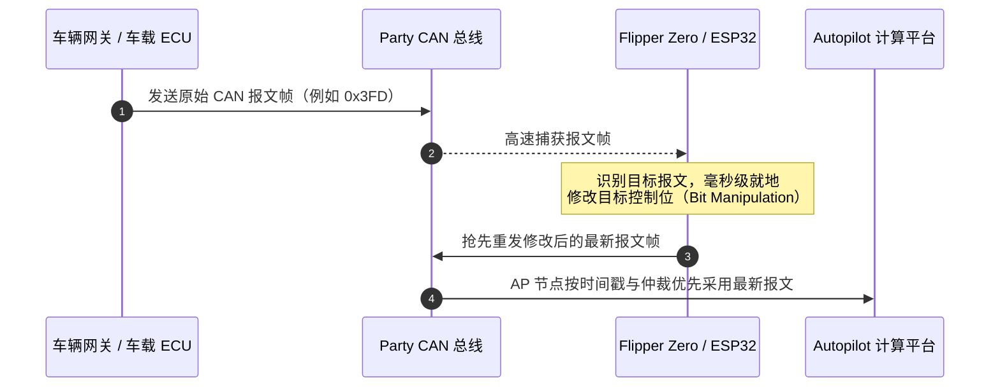

[English](README.md) | [繁體中文](README_zh-TW.md) | [简体中文](README_zh-CN.md)

> [!WARNING]
> **本翻译与英文版同步维护。** 功能规格、CAN ID 报文映射表、硬件引脚接线指南等均严格对照 [英文版 README](README.md)。如发现任何表述差异或最新改动，欢迎提交 PR 完善。

# Tesla Mod for Flipper Zero

[](https://github.com/hypery11/flipper-tesla-fsd/stargazers)
[](https://github.com/hypery11/flipper-tesla-fsd/network)
[](https://github.com/hypery11/flipper-tesla-fsd/releases)
[](https://github.com/hypery11/flipper-tesla-fsd/releases)
[](https://github.com/hypery11/flipper-tesla-fsd/commits/main)
[](https://github.com/hypery11/flipper-tesla-fsd/issues)
[](CONTRIBUTING.md)
[](LICENSE)
[](https://github.com/flipperdevices/flipperzero-ufbt)
[](https://github.com/flipperdevices/flipperzero-firmware)

> **适用于 Flipper Zero 和 ESP32 的开源特斯拉（Tesla）CAN 总线开发工具箱。** 支持 FSD 区域地理围栏绕过、被云端封禁 VIN 车辆的 TLSSC 功能恢复（红绿灯和停车标志控制）、带拟真自然扭矩波动的方向盘脱手告警抑制（Nag Killer）、网关配置重放（GTW Config Replay）、BMS 动力电池实时监控仪表盘，以及覆盖 Model 3、Model Y、Model S 与 Model X 的 30 多个 CAN 报文处理器。全面支持 HW3、HW4 以及老款 Legacy HW1/HW2 硬件。是售价超过 200 美元的 S3XY Commander 模块的高性价比开源替代方案 —— 搭配 [ESP32 移植版](https://github.com/hypery11/flipper-tesla-fsd/tree/main/esp32)，硬件物料总成本最低仅需 **14 美元**。

> [!IMPORTANT]
> **使用 FSD 相关功能必须具备有效的 FSD 软件包授权**（购买买断或按月订阅均可）。本工具仅在 CAN 总线物理与通信层面上使能 FSD 功能逻辑，车辆本身仍须具备特斯拉官方有效的 FSD 功能权限。非 FSD 功能（如方向盘脱手提示抑制 Nag Killer、BMS 实时监控、车辆诊断等）无需任何 FSD 订阅即可正常工作。

> [!CAUTION]
> **特斯拉已开始执行车辆车架号（VIN）级别的云端封禁**（自 2026 年 4 月起）。受影响的车辆会在毫无征兆、无 OTA 推送通知的情况下被静默移除 TLSSC（交通信号灯与停车标志控制）开关；且该状态在车辆账号过户转让或重新付费订阅后依然常驻。**TLSSC Restore** 功能（v2.10+）可通过 `0x331` 报文伪造 DAS 配置，在被封禁的 Palladium 架构（新款 S/X）和 HW4 车辆上恢复红绿灯与停车标志控制。有关封禁机理的完整逆向分析，请参阅 [SECURITY.md](SECURITY.md) 及 [issue #18](https://github.com/hypery11/flipper-tesla-fsd/issues/18)。

<p align="center">
  
</p>

<p align="center">
  &nbsp;&nbsp;&nbsp;
  
</p>

<p align="center">
  <a href="https://star-history.com/#hypery11/flipper-tesla-fsd&Date">
    
  </a>
</p>

<p align="center">
  <a href="https://github.com/hypery11/flipper-tesla-fsd/graphs/contributors">
    
  </a>
</p>

---

## 功能特性

### 核心 FSD 功能
- 基于 `GTW_carConfig`（`0x398`）自动识别 HW3 / HW4；当接入的总线上无 `0x398` 报文时，ESP32 可自动降级通过 `0x39B` / `0x399` / `0x3FD` / `0x3EE` 报文进行备用硬件版本识别
- **Palladium 架构 Model S/X 老款自动平滑升级为 HW3** —— 初始检测到 `das_hw=0`，在总线上捕获到 `0x3FD` 报文后自动升级为 HW3 模式
- 通过修改 `UI_autopilotControl`（`0x3FD` / `0x3EE`）特定数据位（Bit Manipulation）实现 FSD 解锁
- **老款兼容模式（Legacy mode）**：支持配备 HW1 / HW2 的早期 Model S/X（2016–2019 款）
- 巡航速度策略默认设为最快响应，并同步自车距调节拨杆（HW4 / Legacy）。在 HW3 上则保持车辆原生的 FSD 速度偏移量与策略不变；ESP32 的 **HW3 速度覆盖开关（HW3 Speed Override）** 可按需恢复旧版的跟车距离 / AP 巡航偏移写入逻辑（[#209](https://github.com/hypery11/flipper-tesla-fsd/issues/209)）

### TLSSC Restore 信号灯控制恢复（v2.10+）
- 为 **被封禁车架号（VIN-banned）** 的车辆恢复交通信号灯与停车标志控制（Traffic Light and Stop Sign Control，TLSSC）
- 对 CAN ID `0x331` 执行读取-修改-转发 —— 将 `DAS_autopilot` 配置等级强制设为 `SELF_DRIVING`
- 已在 Palladium 架构（Model S Plaid 2023 款）、HW4 Highland（Model 3 高性能版 2024 款）以及 Intel 芯片 HW3（需搭配 AP-First 变通方案）上实车验证成功
- **注意**：该功能仅恢复红绿灯与停车标志控制（TLSSC），**不会**恢复完整的 FSD 全向渲染可视化动效
- **被封禁车辆推荐配置组合**：同时开启 **TLSSC Restore** 与 **TLSSC bit38**（`0x3FD` mux 0 bit 38）—— 由 @RoyRakete 在 HW3 / 2026.2.6 车上实测证实运行可靠（[#18](https://github.com/hypery11/flipper-tesla-fsd/issues/18#issuecomment-4413430516)）。在某些受封禁固件上单独开启任一选项均不稳定；两者结合可稳定重新激活 AP / TACC 接管功能

### 网关配置重放 GTW Config Replay（v2.9+，v2.15 从“Ban Shield”更名）
- 实时监听 `GTW_carConfig`（`0x7FF`），当网关发出被云端篡改/降级的报文时，实时重放此前学习到的正常（健康）总线广播报文
- 首次运行时自动学习全部 8 组多路复用报文（mux frames），随后自动进入待命防护状态（auto-arms）
- **实际作用原理**：仅在总线广播层进行伪装遮蔽。激活后，Autopilot ECU 接收到的是重放的正常配置帧，而非网关发出的降级帧。特斯拉的封禁指令会直接写入网关非易失性存储器（GTW NVRAM，重启依然常驻）以及官方云端标志；本功能无法修改 NVRAM 存储状态或后端记录，仅能实时改变总线上其他 ECU 控制器所读取到的广播数据。
- **无法实现的效果**：不能阻止云端封禁、无法解除封禁状态、也不能修改特斯拉服务器端的车辆权限档案。在 v2.9 至 v2.14 发布的 6 周实车测试中，未曾确认过任何一例成功预防封禁的实际案例。遵循开发透明原则（参见 [#60](https://github.com/hypery11/flipper-tesla-fsd/issues/60) 与 [#67](https://github.com/hypery11/flipper-tesla-fsd/issues/67)），v2.14 中使用的“防封护盾（Ban Shield）”命名存在功能虚标，v2.15 现已更名为真实体现代码机理的“网关配置重放（GTW Config Replay）”。

### 方向盘脱手提示抑制 Nag Killer（v2.1+）
- **DAS 感知智能门控** —— 仅在驾驶辅助系统（DAS）真正触发双手扶盘提醒时才注入响应报文，当系统满意时总线流量为零，完全静默
- **拟真自然扭矩波动** —— 基于 xorshift32 伪随机数算法在 1.00 至 1.80 Nm 范围内进行随机游走微调，并每隔 5 到 9 秒施加一次模拟握盘脉冲。自 v2.16-beta.11 起，所有告警抑制路径扭矩硬性限制在 ±1.8 Nm 以内，峰值安全受控于 1.80 Nm（[#122](https://github.com/hypery11/flipper-tesla-fsd/issues/122)）
- **即时响应握力脉冲（v2.15+）** —— 当检测到 `handsOnLevel` 进入告警需求状态（0 即将提醒 / 3 告警升级）时，系统立刻触发一次握盘脉冲并重置定时周期。消除了 v2.14 及更早版本在周期脉冲空窗期间偶发的 2 秒黄色告警升级问题
- 在 `0x370` 报文上执行电动助力转向系统（EPAS）计数器自增（counter+1）回显，全面抑制 level 0（即将提醒）与 level 3（升级警报）
- **必须接入 Party CAN（X179 接口引脚 2/3）以使 Nag Killer 生效**：`0x370` 报文运行在 Party CAN 总线上 —— 而非 Vehicle CAN（引脚 9/10）；部分线束在 Chassis CAN（引脚 13/14）上的副本报文会触发 2026.14.x 固件的预检保护机制。已在 HW4 固件 2026.20 上通过接入引脚 2/3 实车验证正常（[#100](https://github.com/hypery11/flipper-tesla-fsd/issues/100)）。若单 CAN 开发板接错线对，将因无法捕获报文而无法回显 —— 这是导致“Nag Killer 在 HW4 上毫无反应”的最常见原因。请查阅车辆维修手册接线图（或车机 **Service Mode → CAN Port** 页面）确认你的线束上哪对针脚对应 Party CAN；详见 [HARDWARE.md](HARDWARE.md)。

### AP-First 先行激活模式（v2.14+，专为 2026.14.x 固件设计）
- 特斯拉在 2026.14.x 固件中引入了激活前自检机制（Preflight Check）：若检测到总线上已存在持续的 CAN 报文注入，将直接拦截并阻止 AP / TACC（自适应巡航）的激活
- 开启 **AP-First** 模式后，程序会实时监控 `0x39B` 报文中的 `DAS_autopilotState` 状态，仅在确认 AP 成功接管后才开始注入 `0x3FD`。在 ESP32 上，DAS 状态监测源会根据自动识别到的 HW 硬件版本进行动态匹配。
- Nag Killer（脱手抑制）、TLSSC Restore（红绿灯控制恢复）与 GTW Config Replay（配置重放）不受此影响（它们操作不同的独立 CAN ID）

### 14.x 固件版本重要警示（v2.15+）
- **默认保持开启。** 当该警示开关处于启用状态时，Flipper Zero 运行界面会将 BMS / 状态标志行替换为高亮闪烁的 `!14.x: TX may stop AP` 警示文本。ESP32 网页控制台顶部则会常驻一条可手动关闭的黄色警示横幅。
- 采用保守的默认策略：绝大多数升级到 14.x 固件的车主往往在行驶过程中自动辅助转向意外退出时才意识到自己受到影响。该警示会在用户启用任何主动发送（TX）功能之前提前给出安全告知。
- 可通过 Flipper 设置中的 **On 14.x?** 开关或 ESP32 网页横幅上的 **Dismiss** 按钮（配置持久化保存于 NVS）退出该警示。若你确认车辆仍处于 14.x 之前的旧版本固件，可直接关闭此选项。
- 地区差异说明：各区域市场针对该机制的执行力度有所不同，在缺乏特斯拉直营服务的部分海外市场，检测策略似乎相对宽松。关于 14.x / 2026.20 固件的动态进展，详见持续追踪议题 [#122](https://github.com/hypery11/flipper-tesla-fsd/issues/122)。
- **“在 2026.14.x / .20 / .26.x 固件上能否解锁 FSD？”** 简要结论：**不能** —— 激活前预检（Preflight Check）以及脱离 CAN 总线的云端/车机端区域锁双重拦截了 FSD 解锁；但 Nag Killer（脱手提示抑制）、TLSSC（红绿灯识别恢复）、Summon EU（欧版召唤解锁）以及 CAN 报文抓包功能依然完全可用。详细原理解析请阅读 [FSD-on-14.x FAQ (#168)](https://github.com/hypery11/flipper-tesla-fsd/discussions/168)，相关报文层面的逆向取证证据见 [#163](https://github.com/hypery11/flipper-tesla-fsd/discussions/163)。

### 车辆诊断功能（只读模式，无需 FSD 授权）
- BMS 动力电池实时仪表盘：实时读取电池包总电压、电流、荷电状态 SoC（包含来自 `0x292` 的 BMS 原始数值，ESP32 仪表盘还可同时读取来自 `0x33A` 的车机仪表显示值）以及电池单体极值温度区间
- **车辆性能测试面板（ESP32 网页控制台，只读监控，需手动开启）：** 加速与制动计时器（0-50、0-60 mph、0-100、100-0 km/h 测试，并自动记录单次行车历史最佳成绩）、基于车速一阶导数 dv/dt 实时计算的纵向 G 值估算（无需外置 IMU 传感器）、各车轮滑移率（Wheel Slip %），以及动力电池包实时温度与充放电功率。车速与 G 值估算在任何包含 `0x257` 报文的总线上均可运行；车轮滑移率需要接入 Party CAN（`0x175`）；电池包温度与功率数据则需要接入包含 BMS 报文的 Vehicle CAN。该功能纯只读，不对总线发送任何数据
- 实时车速、方向盘转角、驱动电机输出扭矩、机械制动踏板状态
- DAS 辅助驾驶系统状态：Autopilot 工作状态、方向盘脱手握持提醒等级（Hands-on Nag Level）、自动变道状态、盲区预警状态、前向碰撞预警（FCW）、视觉道路限速识别值
- GTW 网关 Autopilot 权限层级实时回读（NONE / HIGHWAY / ENHANCED / SELF_DRIVING / BASIC）
- 带防抖过滤的 OTA 升级检测机制 —— 在检测到车辆正在进行固件更新时自动挂起所有 CAN TX 发送逻辑，除非用户手动开启 Ignore OTA 强制覆盖开关。只有稳定的“安装中”状态才会触发防护；针对较新批次车辆上 `0x318` byte6 改为循环计数器导致误判的问题已做适配修复（[#183](https://github.com/hypery11/flipper-tesla-fsd/issues/183)）
- 自动泊车挂起保护（Autopark Pause） —— 在车辆执行车机原生自动泊车期间自动暂停一切 CAN 发送动作，泊车完成后自动恢复；FSD 正常激活巡航期间不受影响（[#180](https://github.com/hypery11/flipper-tesla-fsd/issues/180)）

### CAN Capture 报文捕获与测试配置文件（v2.16+）
- **CAN 报文捕获（CAN Capture）** —— 将收到的所有总线报文以 Linux candump 标准格式实时保存到 SD 卡目录（`apps_data/tesla_mod/captures/`）。纯只读操作，在任何特斯拉车型上运行均绝对安全。捕获的数据可直接作为 `tools/tesla_crc_cracker.py` 工具的分析输入。
- **发送测试（Send Test）** —— 从 SD 卡加载用户自定义编写的 `.cantest` 文本配置文件并重放特定的自定义报文。默认处于空跑演练（Dry-Run）安全模式；实际报文发送受到严格的硬件与逻辑联锁控制：**必须在车辆挂入驻车挡（P 挡）且处于完全静止状态**（故障安全闭锁 Fail-Closed 原则）下才允许发送，且在发送每一个报文前均会重新实时校验车速与挡位状态。测试结果会自动记录在日志中以便提交 Bug 分析报告。配置文件格式规范与工作流说明参见 [docs/cantest-format.md](docs/cantest-format.md)，示例文件参见 [examples/example.cantest](examples/example.cantest)。

### 拓展解锁功能（v2.16+，需手动开启，默认保持关闭）

目前仅在 ESP32 网页控制台中提供相关设置项 —— Flipper Zero 菜单中尚未收录这些开关，因此 Flipper 固件绝不会主动设置 Summon 召唤位（bit47）。

- **欧版召唤功能解锁（Summon EU Unlock）** —— 操作 `0x3FD` mux1：清除 bit19（欧洲法规 AP 限制位）并置位 bit47（Summon 使能位），从而在受欧盟法规限制的车型上开启智能召唤功能
- **绿灯自动通过（Continue on Green）** —— 操作 `0x3FD` mux0 bit39 `UI_fsdContinueOnGreenWithCIPV`：在跟随前车行驶时，遇到绿灯可直接平顺通过而无需驾驶员轻拨拨杆或轻踩加速踏板进行人工确认；常与 TLSSC 功能搭配使用
- **右舵车型覆盖（RHD Override）** —— 操作 `0x3F8` bit41 `UI_drivingSide` = RHD。仅适用于英国、香港、澳洲、日本等右舵市场车辆
- **AP 内部开发分支 / 权限层级选择器** —— 操作 `0x3FD` mux1 bits 40-42 `UI_apmv3Branch`：支持切换 Live / Stage / Dev / Stage2 / EAP / Demo。属于实验性功能，仅为非持久化的车机 UI 渲染提示 —— 停止报文注入后立即恢复原状
- **可调赛道模式（Adjustable Track Mode）** —— 操作 `0x313` `UI_trackModeSettings`：支持自定义调节操控平衡（Handling Balance，动力前后分配）、稳定辅助强度（Stability Assist）以及赛道驻车后散热冷却功能，并自动重新计算报文校验和（Checksum）。运行在 Vehicle CAN 总线上；默认设定为旋转偏航 100 / 稳定性 30%，在非 Performance 高性能版配置的车型上同样生效
- **加速模式切换（实验性功能）** —— 操作 `0x334` `UI_powertrainControl` 中的 `UI_pedalMap` 动力踏板映射字段（byte0 bits 5-6）：支持切换 Off（透传原车状态）/ Chill（轻松）/ Standard（标准）/ Performance（高性能），直接将修改值写入车辆原生报文，并保持原报文计数器递增及校验和重算。新模式仅允许在车辆完全静止状态下进行切换；切回 Off 或在行驶过程中通过车机中控屏主动调节模式时，程序将立即恢复为原样透传。车机中控屏幕依然显示车主原本设定的模式。`0x334` 报文仅分布在 Vehicle CAN 和 Chassis CAN 总线上，OBD-II 接口下的 Party CAN 总线并不包含该报文。本功能仅改变油门踏板响应曲线映射，不会提高驱动电机的物理额定功率上限。目前尚未完成全车型实车充分验证。该设计灵感来自 [ColinM-sys/tesla-can-boost](https://github.com/ColinM-sys/tesla-can-boost)（[#211](https://github.com/hypery11/flipper-tesla-fsd/issues/211)）

### 设置选项说明（运行时动态开关）

绝大多数功能开关在 Flipper Zero 和 ESP32 两个版本上均有提供。  
**仅 Flipper 专享**：GTW Config Replay、Emerg. Vehicle、ScrollPress AP、Nav FSD Route、Lane Graph、Tier Override、Dev Mode、Hands-Off、Force LHD、MCP Crystal。  
**仅 ESP32 专享**：FSD Unlock（控制 `0x3FD` FSD 位的主开关，默认关闭）、HW3 Speed Override、Ignore OTA、Abort Guard、Continuous AP、China Mode、Right-Hand Drive、上述拓展解锁功能以及 Hardware 硬件版本选择器（Flipper 则在主菜单中直接提供 Force HW3 / HW4 / Legacy 快捷选项）。

**稳定功能（已完成严谨实车测试）：**

| 设置项 | 功能说明 |
|---------|-------------|
| **Mode（工作模式）** | `Active`（主动工作）/ `Listen-Only`（只听只读）/ `Service`（服务模式）。`Listen-Only` 是**设备初次开机时的默认模式** —— MCP2515 处于硬件级只听模式，在物理电气层面完全无法对外发送（TX）任何报文，绝对安全。 |
| **Nag Killer** | DAS 状态感知的 EPAS counter+1 扭矩响应，带有拟真自然微随机波动。 |
| **Force FSD** | 强制绕过车机界面的 `isFSDSelectedInUI` 勾选状态检查。不会绕过特斯拉服务器端的车辆核心权限 —— 仅影响本地 CAN 总线报文流。 |
| **Ignore OTA** | 即使 `0x318` 报文指示特斯拉官方 OTA 固件更新正在进行，也允许设备在 Active 模式下继续对外发送 CAN 报文。默认保持关闭。 |
| **TLSSC Restore** | 基于 `0x331` 报文伪造 DAS 配置，在被封禁的车辆上恢复红绿灯与停车标志控制功能。触发后会引起 MCU 车机重启一次以载入新状态。 |
| **AP-First (14.x)** | 延后 `0x3FD` 报文的注入时机，直到 AP 自动辅助驾驶成功接管后才开始注入。特斯拉 2026.14.x 固件必备此项。 |
| **GTW Config Replay** | 当检测到网关发送降级配置报文时，实时重放此前学习到的正常 `GTW_carConfig`（`0x7FF`）广播报文。仅在 CAN 广播层进行数据遮蔽 —— 无法还原网关 NVRAM 内部状态或云端封禁记录，不能用于预防封禁。在 v2.15 中由“Ban Shield”更名而来（[#60](https://github.com/hypery11/flipper-tesla-fsd/issues/60), [#67](https://github.com/hypery11/flipper-tesla-fsd/issues/67)）。 |
| **Suppress Chime** | 屏蔽欧盟 ISA 超速警告提示音（仅限 HW4，操作 `0x399`）。在 ESP32 上仅在成功识别到 HW4 硬件后才生效；Legacy / HW3 车型将 `0x399` 作为 DAS 状态源使用。 |
| **Emerg. Vehicle** | 激活紧急特种车辆（警车/救护车等）避让识别标志（仅限 HW4，置位 bit59）。 |
| **Precondition** | 通过发送 `0x082` 报文主动触发动力电池包预热加温流程。 |

**测试阶段功能 Beta（尚未广泛验证，欢迎反馈实车测试结果）：**

| 设置项 | CAN ID | 功能说明 |
|---------|--------|-------------|
| **ScrollPress AP** | `0x3C2` mux=1 | **仅限 HW4 硬件、仅在 Service 服务模式下可用。** 在 `swcRightPressed`（bits 12-13）与 `swcRightScrollTicks`（bits 24-29）信号上模拟人类在方向盘滚轮上的操作时序手势（下压 ~250ms → 上滚 ~150ms → 下压 ~250ms → 上滚），当监测到 `DAS_autopilotState` 状态从 0 上升至 1 时瞬间触发接管 —— 完全不需要改动 `0x3FD`。这是已知的首个绕过 2026.14.x 预检的方法；由 @JakNo 在 Highland HW4 / 2026.14.2 车型上发现并完成台架验证（[#43](https://github.com/hypery11/flipper-tesla-fsd/issues/43)，精细时序流程见 [#82](https://github.com/hypery11/flipper-tesla-fsd/pull/82)）。因 @DmitroPanteliuk 在配备 Intel 芯片的 HW3 / 2026.14.6 车辆上测试该功能报告触发了紧急制动，HW3 架构自 v2.15 起已彻底禁用此功能 |
| **Nav FSD Route** | `0x3F8` bits 13/48/49 | 强制开启基于车载导航路线的 FSD 领航路径规划能力（针对欧盟及受限制地区） |
| **TLSSC bit38** | `0x3FD` mux0 bit38 | 显式置位 TLSSC 激活位；与 TLSSC Restore（0x331）组合使用，是被封禁车辆的官方推荐搭配方案 |
| **Lane Graph** | `0x3FD` mux1 bit45 | `UI_showLaneGraph` —— 在非 FSD 软件层级下强制显示车道拓扑网格动态可视化界面 |
| **Tier Override** | `0x7FF` mux=2 | 强制将 `GTW_autopilot` 等级覆盖为 `SELF_DRIVING`（比 GTW Config Replay 更激进 —— 采用主动篡改写入而非被动重放） |
| **Dev Mode** | `0x3F8` bit5 | 置位 `UI_dasDeveloper` 开发者专属调试标志位 |
| **Right-Hand Drive (RHD)** | `0x3F8` bit41 | 将 `UI_drivingSide` 设为 RHD（置位 bit41、复位 bit40 —— 与旧版 LHD 探测逻辑互斥）。仅供右舵市场使用。严谨说明：此前设计的 Force-LHD 强制左舵方案**经实测证明无效** —— 在被封禁的右舵 HW3 / 2026.2.6 车上，赋值 0/1/2 均会导致 FSD 固执地偏向左舵行驶侧（[#66](https://github.com/hypery11/flipper-tesla-fsd/issues/66)）；因此目前 ESP32 固件直接改为按需发送 RHD 覆盖信号（Flipper 菜单中暂时保留了旧款 Force LHD 开关） |
| **Hands-Off** | `0x3F8` bit14 | 车机 UI 交互层面的脱手警告禁用标志（作为 Nag 告警消除的第二控制向量） |
| **Telemetry Off** | `0x3F8` bits 19/42/43/44/55 + `0x3FD` mux1 bits 48/50 | 清除总线上可触及的遥测上传开关标志（0x3F8 上的行车视频片段 clip / 行程数据 trip / 道路段数据 road-segment，以及 0x3FD 上的座舱红外摄像头 cabin-camera / 中国区定制数据）。属于实验性功能 —— **仅覆盖当前总线暴露的报文标志，无法阻断 Vehicle 总线上各 ECU 的核心底层日志上传，绝非防封禁的免死金牌。** 仅建议在拔除车机 4G/5G SIM 卡脱网环境下配合使用 |

**针对 2026.14.x 固件的实验性功能（默认全部关闭，欢迎提交测试报告）：**

这些选项专门针对特斯拉 2026.14.x / 2026.20 固件的严格行为特征设计，**默认全部保持关闭**。它们属于探索性探测手段，并非已被证实全场景通用的终极修复 —— 实时测试进展请参阅议题 [#122](https://github.com/hypery11/flipper-tesla-fsd/issues/122)。可在 ESP32 网页控制台（或部分已适配的 Flipper Settings）中按需开启。

| 设置项 | 功能说明 |
|---------|-------------|
| **Abort Guard**（ESP32 专享） | 方向盘激活急扯/猛晃缓解技术（[#108](https://github.com/hypery11/flipper-tesla-fsd/issues/108)）。开启辅助驾驶瞬间的方向盘猛晃，本质上是车辆底层正在**主动中止**接管请求（`DAS_autopilotState` 瞬间由 `8 ABORTING` 变为 `9 ABORTED`）。开启此项后，一旦在总线上检测到中止状态，程序会在数微秒内切断所有与激活相关的注入报文，并保持静默直至驾驶员彻底手动脱离接管。**已完成实车测试验证：** 在平直/开阔路况下彻底消除了方向盘抽晃现象（在数百次连续测试中实现 0 次误抽动，未开启前发生概率约为 1/25–30）。已知局限：在部分狭窄道路上系统有时无前置过渡直接跳变到 `FAULT (9)`，此极端情况程序来不及抢先拦截。 |
| **Soft Engage** | 方向盘平顺接管辅助（[#108](https://github.com/hypery11/flipper-tesla-fsd/issues/108)）。在接管初期的临界时刻抑制 CAN 报文注入，直到方向盘物理角度回正到中心 ±5° 以内才释放。要求接入的总线必须存在 `0x129`（方向盘物理转角）报文；若总线缺少该报文，系统将自动降级为单纯的 AP-First 模式。对于直线道路下的方向盘晃动问题，该功能已基本被 Abort Guard 完美取代。 |
| **Nag Burst** | 将 `0x370` 报文的发送节奏由恒定连续注入改为脉冲突发式回显（约开启 1 秒 / 暂停 1.5 秒）（[#122](https://github.com/hypery11/flipper-tesla-fsd/issues/122)）。周期性间歇静默期被认为是市面上部分商业改装硬件得以躲过 14.x 更严苛脱手检测算法的核心机制。建议配合 ±1.8 Nm 的转向扭矩硬限幅共同使用。 |
| **EPAS-faithful (Mode-C)** | 真实模拟转向机状态的扭矩反馈模型，取代简单翻转 `handsOnLevel` 信号的传统做法（[#100](https://github.com/hypery11/flipper-tesla-fsd/issues/100)）。专门面向标准 Nag 消除算法会触发 Preflight 预检拦截的特定车型固件。**目前尚处于待实车确认状态。** |
| **Instant Engage** | 极速接管响应与激活延迟对照测试 A/B 开关（[#108](https://github.com/hypery11/flipper-tesla-fsd/issues/108), [#129](https://github.com/hypery11/flipper-tesla-fsd/issues/129)）。在开启 AP-First 的前提下，只要 AP 一旦被激活（DAS 状态 ≥ 3）便立即开始注入报文，不再等待默认的 1 秒稳定性防抖去抖周期。而在 AP 仅处于可用待命状态（状态 2）时依然严格保持静默。 |
| **Minimal Inject** | 狭窄弯道方向盘抽动探测模式（[#108](https://github.com/hypery11/flipper-tesla-fsd/issues/108)）。在每次辅助驾驶刚接管的瞬间仅向总线注入极短的一组报文（共 5 帧），随后彻底停发，直至车辆退出接管状态。可与 Instant Engage 叠加组合使用。 |
| **Signal Map**（ESP32 → 高级自定义设置） | 允许高级玩家自定义覆盖 Nag Killer 提取 AP 状态、脱手警示、转向角度的 CAN 信号映射规则：支持自定义配置 `id + byte/shift/mask`（[#122](https://github.com/hypery11/flipper-tesla-fsd/issues/122)）。适用于部分报文布局特殊的改款车型或海外定制版。配备报文时效性硬校验门控 —— 若映射规则错误将自动执行故障安全闭锁（Fail-Closed，停发报文），并在网页控制台显示映射的 DAS ID 从未在总线上出现的警示。掩码 mask 设为 `0` 的字段将被自动忽略。若将 DAS ID 设为 `0` 则保持默认自动识别。Flipper 端则提供了便捷的预设切换列表（Auto / `0x39B` b0 / `0x39B` b1 / `0x399` b0）。 |

**底层硬件设置（Hardware）：**

| 设置项 | 功能说明 |
|---------|-------------|
| **MCP Crystal** | 支持切换 16 / 8 / 12 MHz —— 必须严格匹配你的 MCP2515 CAN 模块板载晶振物理频率。 |
| **Hardware**（ESP32） | 支持选择 Auto-detect（自动侦测）/ Force HW4 / Force HW3 / Force Legacy。自动识别机制依赖于 `0x398` 报文，然而在部分线束配置下的 Model 3/Y 总线上该报文并不广播 —— 若自动识别有误，请手动锁定为适合你爱车的硬件版本。配置自动持久化写入 NVS，每次开机自启生效。 |

### 硬件支持度一览

| 特斯拉计算平台 | 修改的核心数据位 | 巡航速度档位逻辑 |
|----------|------------|----------|
| **Legacy（老款 HW1/HW2）** | bit46 | 3 档可调（0-2） |
| **HW3** | bit46 | 沿用车辆原生逻辑（开启 HW3 Speed Override 覆盖时变为 3 档） |
| **HW4（FSD V14+）** | bit46 + bit60 | 5 档可调（0-4） |

---

## 硬件选型与连接

### Flipper Zero 硬件清单
| 硬件组件 | 功能说明 | 参考成本 |
|------|------|------|
| [Flipper Zero](https://flipper.net/) | 多功能便携安全调试设备本体 | 约 $170 |
| [Electronic Cats CAN Bus 扩展板](https://electroniccats.com/store/flipper-addon-canbus/) | 基于 MCP2515 的专用 CAN 收发扩展模块（兼容 v1.2） | 约 $30 |
| OBD-II 专用诊断线 或 X179 端子转接线 | 连接车辆底盘总线的物理线缆 | 约 $5–10 |

### ESP32 硬件方案（物料成本 $14 起）
功能完备的独立 ESP32 移植方案，内置 WiFi 网页管理控制台、NVS 非易失参数存储、深度休眠省电与一键恢复出厂设置功能。其核心底层 CAN 处理引擎与 Flipper Zero 端完全同源同步；仅有极个别特性因硬件差异专属于单端平台（详见上述设置说明）。

ESP32 固件在不同检测到的硬件平台上自动匹配 AP/DAS 状态的信号监听源：

| 识别到的硬件版本 | `0x399` 报文用途 | `0x39B` 报文用途 | ISA 超速警报音抑制 |
|-------------|---------|---------|----------------|
| **Legacy HW1/HW2** | `DAS_status` 状态来源 | *(不读取)* | *(不支持)* |
| **HW3** | `DAS_status` 状态来源 | *(不读取)* | *(不支持)* |
| **HW4** | `ISA_SPEED` 警报音屏蔽 | `DAS_status` 状态来源 | **支持** |

支持的 ESP32 硬件开发板型号与编译目标：

| 开发板型号 | 参考成本 | 对应编译目标（Build Target） |
|-------|------|-------------|
| M5Stack ATOM Lite + ATOMIC CAN 扩展底座 | 约 $14 | `m5stack-atom` |
| Lilygo T-CAN485 | 约 $15 | `esp32-lilygo` |
| Waveshare ESP32-S3-RS485-CAN | 约 $18 | `waveshare-s3-can` |
| LilyGO TTGO T-Display + MCP2515 模块 | 约 $20 | `ttgo-tdisplay` |
| LilyGO T-2CAN（双路 CAN 接口） | 约 $24 | `lilygo-t2can` |
| LilyGO T-2CAN FD（双路 CAN，带 MCP2518FD 芯片） | 约 $25 | `lilygo-t2can-fd` |
| 通用 ESP32 开发板 + MCP2515 模块 | 约 $6 | `esp32-mcp2515` |

详细配置说明请参阅 [`esp32/README.md`](https://github.com/hypery11/flipper-tesla-fsd/tree/main/esp32)，完整硬件对比、接线图与 X179 端子引脚定义请参阅 [`HARDWARE.md`](HARDWARE.md)。

### 车辆总线物理接线位置

- **OBD-II 诊断接口** —— 承载 Party CAN 总线。在 2019+ 款 Model 3 以及 2020 至 2024 年 4 月生产的 Model Y 上，该物理接口位于后排中央扶手箱/空调出风口下方区域，必须配合特斯拉专用的 OBD 转接配线连接；2024 款以后的 Juniper 改款及部分新款 Highland 车型已将该处接口升级为 DoIP（以太网车载诊断），不再包含 CAN 信号。此外，在部分 Model 3/Y 批次上，挂入前进挡（D 挡）行驶时该接口的总线通信可能会被网关静默。
- **X179 接口（位于后排中控台内侧）** —— **官方强烈推荐的连接位置**。不同批次与车型配置的线束在引脚与总线的对应关系上存在差异，在动手接线前，请务必核对你爱车的官方电气维修图纸（在车机中打开 **Service Mode 服务模式 → CAN Port** 页面即可直观查看物理引脚定义）。关于 20-pin 与 26-pin 接口详细引脚分配定义以及特斯拉官方电路参考文档链接，请详阅 [`HARDWARE.md`](HARDWARE.md)。

<p align="center">
  
</p>

---

## 安装部署

### 快速入门指南（无需搭建编译环境）

初次接触本项目的非开发人员？根据你的硬件选择最便捷的部署路径 —— 两种方式均无需使用终端命令行：

**针对 Flipper Zero 用户**

最省心的方式是直接通过 Flipper 官方应用商店安装：在手机端打开 Flipper 移动客户端 App，进入 **Apps** 标签页搜索 **Tesla Mod**；或者直接在电脑浏览器中访问 [lab.flipper.net/apps/tesla_mod](https://lab.flipper.net/apps/tesla_mod) 进行一键在线安装。商店版本跟随稳定版发布；如果你希望抢先体验包含最新特性的 Pre-release 测试版，可直接手动安装官方 Release 包中的 `.fap` 文件：

1. 访问本项目的 [Releases](https://github.com/hypery11/flipper-tesla-fsd/releases) 页面，下载对应版本的 `tesla_mod.fap` 文件（测试版本会标注为 Pre-release 标签）。
2. 将 Flipper Zero 通过 USB 连接至电脑，打开 [qFlipper](https://flipperzero.one/update) 客户端。
3. 将 `tesla_mod.fap` 拷贝到 SD 卡的 `apps/GPIO/` 目录中。
4. 在 Flipper 上打开：**Apps → GPIO → Tesla Mod**。

**针对 ESP32 用户 —— 直接在浏览器中一键在线刷入，无需安装任何开发工具：**
1. 获取刷机工具：在桌面端通过 **Chrome、Edge 或 Opera** 浏览器打开在线托管的 **[Web Flasher 在线烧录器](https://hypery11.github.io/flipper-tesla-fsd/install/)**；或者从最新 [Release](https://github.com/hypery11/flipper-tesla-fsd/releases) 页面下载 `tesla-flasher.html` 文件并在本地双击打开。
2. 使用 USB 数据线连接开发板，点击对应板型旁边的 **Install** 按钮，并在弹出窗口中选择对应的 USB 串口端口。
3. 烧录完成后，用手机或电脑连接开发板广播出的 Wi-Fi 热点，并在浏览器中打开 `http://192.168.4.1` 即可进入管理控制台。

开发板在初次开机时会默认处于 **Listen-Only 只听只读模式**（物理上完全无法发送报文），直到你在网页控制台中手动切换为 Active 模式。接入车辆的具体接线取决于你爱车的特斯拉车型与年份 —— 详见 [HARDWARE.md](HARDWARE.md) 或提交 issue 咨询。

---

### 进阶选项 1：直接下载预编译 FAP 文件

1. 访问项目的 [Releases](https://github.com/hypery11/flipper-tesla-fsd/releases) 发行页面
2. 下载最新构建的 `tesla_mod.fap` 预编译二进制文件
3. 将文件拷贝至 Flipper MicroSD 卡的对应位置：`SD Card/apps/GPIO/tesla_mod.fap`

### 进阶选项 2：从源代码自主构建

```bash
git clone https://github.com/hypery11/flipper-tesla-fsd.git
cd flipper-tesla-fsd
ufbt
# 编译产物位于：dist/tesla_mod.fap
```

### ESP32 源码编译方式

> 不想配置本地构建环境？推荐直接使用 **[Web Flasher 在线烧录器](https://hypery11.github.io/flipper-tesla-fsd/install/)** 烧录官方镜像 —— 一键在线刷写，无需安装任何交叉编译器工具链。

```bash
git clone https://github.com/hypery11/flipper-tesla-fsd.git
cd flipper-tesla-fsd/esp32
pio run -e m5stack-atom    # 或针对其它板型编译：esp32-lilygo、waveshare-s3-can、esp32-mcp2515、ttgo-tdisplay、lilygo-t2can、lilygo-t2can-fd
```

---

## 使用操作流程

1. 将 CAN 扩展模块牢固插接到 Flipper Zero（或给已烧录固件的 ESP32 上电）
2. 将模块的 CAN-H 和 CAN-L 差分信号线，通过 OBD-II 诊断口或 X179 端子正确跨接到车辆总线上（具体哪对引脚对应哪路总线，请以爱车的官方电路图或 Service Mode → CAN Port 页面显示为准）
3. 在设备上打开应用：`Apps > GPIO > Tesla Mod`
4. 选择并进入 **"Auto Detect & Start"**（或按需手动强制指定 Force HW3 / HW4 / Legacy 架构）
5. 观察屏幕等待总线识别（通常最长耗时 8 秒）—— Palladium 架构的 Model S/X 会自动从 Legacy 升级到 HW3
6. 当车主在车机设置中开启 TLSSC 开关后，应用程序便会在后台静默且精准地执行实时的 CAN 报文位修改与转发

---

## 车型兼容性与实测反馈

### 社区实测确认可用车型

| 车型与改款 | 硬件平台 | 搭载固件版本 | 验证测试者 | 实测生效功能 |
|------|----|------|--------|------|
| **Model S Plaid 2023（Palladium 架构）** | HW3 / MCU3 | 2026.2.9.3 | @MiniCS, @nagotti | TLSSC Restore 信号灯控制恢复、FSD 解锁 |
| **Model 3 Highland Performance 2024** | HW4 | 2026.8.6 | @kp43h8 | TLSSC Restore 恢复，拔下设备后依然持续生效 |
| **Model 3 2019–2023 款** | HW3 | 多个固件版本 | @THER4iN 等多位车友 | FSD 解锁、Nag Killer 方向盘脱手抑制 |
| **Model X Raven 2017 款（升级 HW3 芯片）** | HW3 / MCU2 | 2026.8.3 | @dmagyar | Nag Killer 脱手抑制、EAP 增强版辅助驾驶 |
| **Model Y 2023 款（中国制造 MIC 版）** | HW3 | 2026.2.11 | 社区车友验证 | FSD 解锁（需使用 Force FSD 模式） |
| **Model 3/Y 2023+ 款** | HW4 | < 2026.2.9 | @vbarrier, @kwangseok73-sudo | FSD 解锁正常 |

### 已知系统限制与变通方案

| 固件版本分水岭 | 遇到的具体问题 | 推荐的应对变通方案（Workaround） |
|----------|-------|------------|
| **2026.8.6+** | 区域地理锁 —— FSD 深度神经网络在部分非白名单国家/地区拒绝加载运行 | 拔出车机实体 4G/5G SIM 卡脱网，在设置中开启 Force FSD |
| **2026.8.6 HW4 架构** | 特斯拉在该特定版本中使原有的 HW4 注入链路发生异常 | 手动选择 Force HW3 兼容工作模式 |
| **Intel 芯片 HW3（被云端封禁车型）** | 虽可通过 `0x331` 成功找回车机界面的 TLSSC 开关，但直接开启会导致 AP 接管失效 | 采用 AP-First 先行激活策略：在 AP 成功激活后再注入 `0x3FD` 中的 TLSSC 标志位 |

欢迎使用 [车型兼容性反馈模板（Car compatibility report）](https://github.com/hypery11/flipper-tesla-fsd/issues/new?template=car_compatibility.yml) 提交你爱车的实测数据，帮助丰富社区知识库！

---

## 底层技术原理

本工具在车内 **Party CAN** 总线上运行极其高效的**单总线读取-修改-转发（Read-Modify-Retransmit）**机制。无需搭建复杂的双端口中间人（MITM）硬件拓扑，也无需同时飞线跨接第二路总线。



1. 特斯拉车载网关（Gateway）或相应 ECU 节点向 CAN 总线广播原生报文。
2. Flipper Zero 或 ESP32 在极微秒级别捕获该报文，就地修改目标功能标志位。
3. 立即重发修改后的数据包 —— 接收端 ECU 遵循协议自动以收到的最新有效帧作为当前控制决策依据。

### 核心介入的 CAN ID 报文清单

| CAN ID | 官方报文名称 | 通信方向 | 核心功用与实现逻辑 |
|--------|------|-----------|------|
| `0x331` | `DAS_autopilotConfig` | TX（发送） | **TLSSC Restore 恢复** —— 将自动驾驶配置权限等级强制伪造为 `SELF_DRIVING` |
| `0x370` | `EPAS3P_sysStatus` | TX（发送） | **Nag Killer 脱手抑制** —— 执行 counter+1 递增回显，并施加 1.00-1.80 Nm 拟真自然波动扭矩 |
| `0x3FD` | `UI_autopilotControl` | TX（发送） | **FSD 核心解锁** —— 修改 bit46/60（HW3/HW4 激活）、置位 TLSSC bit38、使能 Lane Graph 车道图 bit45 |
| `0x3F8` | `UI_driverAssistControl` | TX（发送） | **辅助驾驶控制** —— 导航辅助驾驶 Routing、Hands-off、开发者模式、右舵 RHD 标志（bit41）、遥测屏蔽 Telemetry-off（测试版） |
| `0x3EE` | `UI_autopilotControl` | TX（发送） | **FSD 核心解锁（老款）** —— 面向 Legacy HW1/HW2 硬件架构 |
| `0x3C2` | `VCLEFT_switchStatus` | TX（发送） | **ScrollPress AP 物理滚轮手势注入（仅限 HW4）** —— 在 mux=1 信号上模拟人类在方向盘右滚轮的时序按压手势（Service 模式，测试版） |
| `0x7FF` | `GTW_carConfig` | TX（发送） | **GTW Config Replay 网关重放** —— 实时伪装重放先前捕获的未受限制配置广播，并支持主动层级覆盖 |
| `0x082` | `UI_tripPlanning` | TX（发送） | **电池热管理预热触发** —— 主动触发动力电池包前往超充站级别的加热预处理逻辑 |
| `0x313` | `UI_trackModeSettings` | TX（发送） | **赛道模式参数注入** —— 操控平衡比 / 稳定性辅助 / 赛道后降温（自动重算校验和；运行在 Vehicle CAN 总线上） |
| `0x334` | `UI_powertrainControl` | TX（发送） | **加速踏板响应模式覆盖（实验性）** —— 修改 `UI_pedalMap`（byte0 bits 5-6），仅限车辆静止时设置（重算校验和、保持计数器；运行在 Vehicle / Chassis 总线） |
| `0x398` | `GTW_carConfig` | RX（只读） | **HW 硬件版本检测** —— 自动识别 HW3 / HW4 计算平台架构 |
| `0x318` | `GTW_carState` | RX（只读） | **OTA 状态检测** —— 监测到车辆固件更新时自动挂起所有 CAN TX 发送逻辑 |
| `0x399` | `DAS_status` (HW3/Legacy) / `ISA_speedLimit` (HW4) | RX/TX | **硬件架构自适应调度（双端支持）**：Highland 之前的 HW3 和 Legacy 架构将其作为 `DAS_status` 读取（AP 状态 + 脱手警示）；HW4 架构重写其数据用于 Suppress Chime 屏蔽超速音，并在车辆未广播 `0x39B` 时从中读取脱手警示等级 |
| `0x39B` | `DAS_status` | RX（只读） | **HW4 与 Highland HW3 专属状态源** —— 读取 AP 状态（byte0 低 4 位，供 AP-First 使用）、自动泊车标志（用于 Autopark 挂起）、脱手等级、变道状态、盲区预警 |
| `0x132` | `BMS_hvBusStatus` | RX（只读） | **BMS 高压电气状态** —— 采集动力电池包总电压与工作电流 |
| `0x292` | `BMS_socStatus` | RX（只读） | **BMS 原始荷电状态** —— 读取 `BMS_socUI`（bit 10，分辨率 0.1%），作为两个客户端界面的标准 BMS 显示值 |
| `0x312` | `BMS_thermalStatus` | RX（只读） | **动力电池包温度** —— 采集电池单体温度（部分车型线束排列未完全确认；异常离谱读数会被自动过滤隐藏） |
| `0x33A` | `UI_range` | RX（只读） | **车机剩余电量** —— 读取车机中控屏幕面向车主显示的官方 SoC 百分比（ESP32 控制台电池卡片） |

包含全部 40 个报文处理器（17 个 TX 发送，23 个 RX 接收）的完整源代码清单请查阅 [`fsd_logic/fsd_handler.h`](fsd_logic/fsd_handler.h)。

---

## 常见问题解答（FAQ）

**将设备从车上拔下后，FSD 解锁状态还会保持吗？**  
**不会。** 本工具的工作机制是基于毫秒级的实时 CAN 报文修改与总线转发。设备一旦拔除或断电，CAN 总线报文流瞬间恢复为特斯拉原厂状态，相关解锁功能立即失效。

**没有购买或订阅 FSD 的车辆可以使用本工具吗？**  
FSD 核心高阶功能（包括城市道路领航、TLSSC 红绿灯与停车标志识别控制）**必须依赖车辆拥有特斯拉官方颁发的有效 FSD 软件功能授权**。若车辆未购买或订阅 FSD，车载 Autopilot 核心计算单元中根本不会加载对应的深度神经网络大模型权重文件，因此物理层面无法运行自动驾驶。然而，所有**非 FSD 专属的功能**（包括方向盘脱手告警抑制 Nag Killer、BMS 动力电池监控、超速提示音抑制、车辆各项性能数据诊断等）在任何具备基础 AP 硬件的特斯拉车辆上均可免订阅直接使用。

**特斯拉的 VIN 车架号云端封禁机制是如何运作的？**  
自 2026 年 4 月起，特斯拉在服务器端引入了针对车架号的封禁限制。一旦车辆被官方云端标记，后端指令会将网关的 `GTW_autopilot` 配置等级由原先的 `SELF_DRIVING` 强制降级为 `ENHANCED`，并在车机屏幕上彻底隐藏且移除 TLSSC 设置开关。本项目的 **TLSSC Restore** 功能（通过 `0x331` 报文）已在 Palladium 架构与 HW4 车型上成功实现了 TLSSC 交通信号灯控制开关的物理级强制恢复与使用，详见 [issue #18](https://github.com/hypery11/flipper-tesla-fsd/issues/18) 的完整封禁分析。**GTW Config Replay**（`0x7FF`，原名“Ban Shield”）可实时重放先前学到的健康配置，但其仅作用于 CAN 总线广播层 —— 无法撤销底层 NVRAM 或服务器端的真实封禁状态。

**Flipper Zero 与 ESP32 —— 我应该选择哪款硬件？**  
ESP32 方案性价比极高（物料成本仅约 $14，而 Flipper 设备通常超 $200），且自带 WiFi 网页管理控制台、NVS 参数持久化保存与深度休眠省电功能。Flipper Zero 的优势在于一体化便携性强且自带物理显示屏。两套固件运行完全相同的底层核心 CAN 处理逻辑（仅少数特定开关在单端存在，详见设置列表）。如果你目前尚未拥有 Flipper Zero，强烈建议直接入手 ESP32。

**本项目是否支持特斯拉 Model S 与 Model X 车型？**  
**完美支持。** Palladium 架构的 Model S/X（2021 款起的新款）已由社区证实可通过 TLSSC Restore 正常恢复功能。配备早期架构并改装了 HW3 硬件的 2021 年前老款 Model S/X 则可通过 Legacy→HW3 自动升级逻辑无缝工作。配有 HW1/HW2 的极老款 Model S/X 可使用 Legacy 模式（`0x3EE`）。请注意：Model S/X 采用了与 Model 3/Y 不同的 BMS CAN ID 体系 —— BMS 仪表盘在此类车型上可能会显示不准确的数值。

**使用 Flipper Zero 方案时，我必须购买 CAN 扩展模块吗？**  
对于 Flipper Zero 用户：**必须购买**，支持任何基于 MCP2515 芯片打造的扩展模块（如 Electronic Cats 官方扩展板或各种通用扩展模块）。对于 ESP32 用户：绝大多数推荐的成品开发板均已在板载集成了 CAN 收发芯片（如 M5Stack ATOMIC CAN、Lilygo T-CAN485、Waveshare S3 等），无需额外加购外置收发模块。

---

## 社区相关项目

| 项目名称 | 简介说明 | 采用的硬件架构 |
|---------|------------|----------|
| [ev-open-can-tools](https://github.com/ev-open-can-tools/ev-open-can-tools) | 上游社区核心项目。目前核心开发力量集中在 GitHub 仓库（v3.1.x 为稳定分支，v4.0 处于活跃测试阶段，采用 GPL-3.0 协议开源）。前身是托管于 GitLab 的 `Tesla-OPEN-CAN-MOD`（该群组现已更名为 `ev-open-can-tools`，GitLab 仓库已停止维护，请移步关注 GitHub 官方主仓库）。 | RP2040 CAN、Feather M4、ESP32 系列 |
| [dzid26/ESP32-DualCAN](https://github.com/dzid26/ESP32-DualCAN) | “Dorky Commander” —— S3XY Commander 模块的开源硬件替代方案 | ESP32 + 双路 CAN |
| [tuncasoftbildik/tesla-can-mod](https://github.com/tuncasoftbildik/tesla-can-mod) | 带有报文模板的 Arduino 参考实现 | Arduino + MCP2515 |
| [tumik/S3XY-candump](https://github.com/tumik/S3XY-candump) | 基于 S3XY Commander 模块（采用 Panda 协议）的 Python CAN 报文抓包工具 | S3XY Commander 硬件模块 |

---

## 鸣谢致谢

- [commaai/opendbc](https://github.com/commaai/opendbc) — 感谢提供极其详尽的特斯拉全系车型 CAN 信号数据库 DBC 定义
- [ElectronicCats/flipper-MCP2515-CANBUS](https://github.com/ElectronicCats/flipper-MCP2515-CANBUS) — 感谢为 Flipper Zero 打造的优秀 MCP2515 驱动库
- 社区所有核心贡献者 —— 感谢大家冒着风险开展的实车测试、报文抓包分析与无私奉献的代码研究：
  - **通信协议、脱手抑制 Nag Killer 与 2026.14.x 固件攻坚：** @jewelrylin (T-2CAN dual-bus captures, the frame-content preflight test, the X179 Service Mode pinout), @DrStrangeglovebox (the Feifan `0x370` reference capture + HW4 dual-CAN data + safety findings), @ssw0209-sys (the Mode-C steering-torque reference + HW4 14.x testing), @0xAccretion (HW4 Highland China-MIC DAS-layout findings, #116/#117), @dunckencn (China HW3 start-after-AP validation, steer-jerk + bus-off reports), @kristopf007 (HW4 14.x on-car testing), @anoblekman (Highland HW4 DAS decode + the in-car Autopark safety finding, #177/#180), @SkyRaax (nag killer on Party CAN 2/3, HW4 2026.20, #100), @LonelyCheese09 (labelled HW3 2026.14.6 nag captures behind the EPAS-faithful fix, #122), @jim608 (labelled HW3 2026.14.6 nag captures behind the EPAS-faithful fix, #121/#122), @weigibbor (2026.20 China-MIC capture + region-lock tier TX-test, #117), @7hf6cfqzkb-png (activation-lag report that led to Instant Engage, #129), @cquanu (first 2026.14.2 incompatibility report, #52), @deftdawg (on-demand grip pulse testing + integration, #70; TTGO T-Display test reports), @zdenekbouresh (DAS-aware nag gating, ported from ev-open-can-tools PR #5)
  - **新特性开发、报文抓包与高质量 PR：** @JakNo (ScrollPress AP / `0x3C2`), @vrs11 (Continuous AP; T-2CAN multi-ID capture filters, #210), @sqladm1n (RTC capture-log PR + bus/wiring investigation), @DmitroPanteliuk (full-rate `0x229` captures), @se7en7777777 (`0x485` / Highland / checksum analysis), @RoyRakete (TLSSC banned-car combo), @mamixsystem (post-SOP10 connector reference; the definitive frame-level 14.x FSD-engage investigation, #163), @p0sixturtle (Summon / tier-selector pointers, #139), @dahua910 (RHD request, #66), @HamzaObaidat (theatre-mode `0x118` research, #149), @fboulegue (EU / new-harness Juniper reports, #143/#109/#110), @densen2014 (ESP32 HW-selector suggestion #110, TLSSC bit38 toggle PR #159, Summon drive-gear safety-guard suggestion #160), @Tesla234987234sdf (Palladium OTA-latch report + captures, #183/#175; the EU charge-port type on `0x25D` and its on-car validation, and the dedicated-RX and whitelist architecture behind the opt-in RX ID whitelist, #228), @tommybsb-lab (ATOM Lite / Juniper field report behind the Signal Map fixes, #100), @sb1089 (HW3 2026.26 nag capture, #122), @ukinora (independent `0x318` rolling-counter analysis; from their fork: the `0x3C2` bus hint, `canstat`, the 12 V / reset-reason logic, the TPMS groundwork, the `0x33A` car SOC decode, the speed SNA guard, the clock-wrap fix, the power-log correction write and the time-budget black-box save, #218/#237/#251), @adrianpadure99 (web-flasher "can't fetch" report, #176), @danpadure (Autopark-pause-in-traffic report, and the black-box records that found the `0x129` steering-angle, stop-and-go Autopark, and stale-frame-retransmit bugs, #176; HW3 FSD speed-offset report, #209), @Jclevy-CN (HW4 speed-profile bit-63 bug + on-car A/B, #59; ESP32 hardening ideas from their fork), @siksndavis (missing ESP32 Precondition toggle, #192), @maslyankov (M5Stack ATOM Matrix + GPIO 39 button, PR #46), @BenjaminFaal (`0x485` gear-shift frame on Juniper, #43), @jangshik (ESP32 Wi-Fi AP+STA request #101, T-2CAN config #96), @TzCoMe (telemetry-disable research behind Telemetry Off), @0n3-70uch (oscilloscope pin map of a post-April-2024 26-pin connector, #52), @TianzeWang (Tesla SOP8/SOP9 electrical-reference pointers, #52), @Tikernel (positive Model Y Juniper HW4 2026.2.11 China compat data), @LeeSSXX (Momentum / Xtreme build error report, #17), @nobless (Acceleration Mode request, #211; captive portal report + fork reliability pointers, #218/#219; the beta.38 dashboard / Wi-Fi regression reports and the beta.40 confirmation on the T-2CAN from macOS and iOS, #223/#225; 2024-07 Fremont Model Y 18/19 capture, and the dumps and black-box records behind the `0x129` steering-angle fix, #211; TPMS, hostname, CAN Bus card and battery requests, #237/#225/#251–#254; the T-2CAN FD boards and the first FD test run, #206; the photo of the car's tyre screen that settled the TPMS wheel order, #237; the move-web-to-its-own-core suggestion and busy-bus reports behind the opt-in core-0 web server and RX ID whitelist, #270/#206), @olschmalz-cyber (Wi-Fi drop-loop report on beta.38 and the four-device test that pinned it on the board, then the beta.40 confirmation on two boards, #230), @pirozhkov095-ctrl (first on-board stack / heap reading after the fix, #230), @vanyasvl (original Boost request, #63), @ColinM-sys (tesla-can-boost, the pedal-map idea behind Acceleration Mode), @i520e3e4 (zh-Hans + zh-Hant web dashboard translation, #205; T-2CAN FD request, #206), @mxkr303 (2020 Model 3 SOP4 X120 Party-CAN wiring writeup, and the reports behind the low-memory black-box save and enable fixes and the MCP2515 power docs, #191), @boddyua (the Wi-Fi-drop loop-stall diagnosis and heartbeat fix, #270)
  - **封禁机理研究、跨平台测试、ESP32 移植与 Bug 修复：** @THER4iN, @MiniCS, @kp43h8, @gauner1986, @dmagyar, @ViPiMP, @marcobellinoroci-source, @danpadure, @bruvv, @Symness, @hkloudou, @nagotti, @patatman, @JordanzhaoD
- `Starmixcraft/tesla-fsd-can-mod` — 早期 CanFeather FSD 研究的开源先驱（原 GitLab 仓库现已被官方移除；社区备份镜像可见 [Karolynaz/waymo-fsd-can-mod](https://github.com/Karolynaz/waymo-fsd-can-mod)）

---

## 赞助支持本研究

如果本项目为您节省了购买高昂第三方商业改装外设的开销、帮助您深入理解了特斯拉车载 CAN 总线的通信机理，或在车辆遭遇云端封禁后成功帮您挽回了 TLSSC 功能，欢迎通过赞助支持开发团队持续开展更深入的逆向研究与实车测试。

[](https://fsd.fkey.id/) [](https://www.paypal.com/cgi-bin/webscr?cmd=_xclick&business=hypery11@gmail.com&item_name=Tesla+FSD+Open+Source+Research&currency_code=USD) [](https://github.com/sponsors/hypery11)

加密货币捐赠请访问 **[fsd.fkey.id](https://fsd.fkey.id/)** —— 单一收款地址，支持多链转账。打开页面即可查看当前支持的网络。

所有捐赠资金将专门用于采购实车测试所需的特斯拉原厂零配件（用于恢复遭封禁的 VIN 车辆、测试不同的 MCU / HW 组合）、各种 ESP32 硬件衍生开发板，以及逆向分析特斯拉最新版本固件所投入的研究精力。

---

## 开源许可证

本项目基于 [GPL-3.0 许可证协议](LICENSE) 全文开源。

---

## 免责声明

本工具及其全部文档仅供个人学习、技术探讨与网络安全学术研究用途。**FSD 是特斯拉官方受知识产权与商业授权保护的高级付费功能，必须通过官方正规渠道合法购买或订阅开通。** 对车辆底层电子电气系统进行改装可能会影响整车质保（保修政策），在部分国家或地区可能违反当地道路交通法规。使用者须对自身的一切操作行为与后果承担全部法律责任与安全风险。使用前请务必完整阅读并严格遵守 [`SECURITY.md`](SECURITY.md) 中的安全指引与负责任使用规范。
