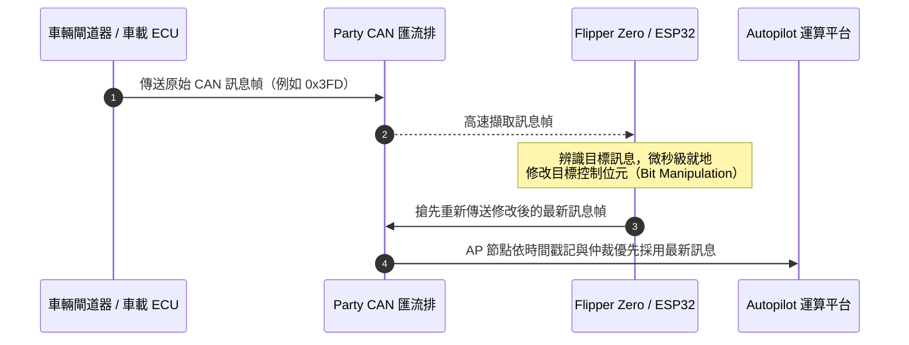

[English](README.md) | [繁體中文](README_zh-TW.md) | [简体中文](README_zh-CN.md)

> [!WARNING]
> **本翻譯與英文版同步維護。** 功能規格、CAN ID 訊息對照表、硬體接腳配線指南等均嚴格對照 [英文版 README](README.md)。若發現任何文意出入或最新更新，歡迎提交 PR 協助完善。

# Tesla Mod for Flipper Zero

[](https://github.com/hypery11/flipper-tesla-fsd/stargazers)
[](https://github.com/hypery11/flipper-tesla-fsd/network)
[](https://github.com/hypery11/flipper-tesla-fsd/releases)
[](https://github.com/hypery11/flipper-tesla-fsd/releases)
[](https://github.com/hypery11/flipper-tesla-fsd/commits/main)
[](https://github.com/hypery11/flipper-tesla-fsd/issues)
[](CONTRIBUTING.md)
[](LICENSE)
[](https://github.com/flipperdevices/flipperzero-ufbt)
[](https://github.com/flipperdevices/flipperzero-firmware)

> **適用於 Flipper Zero 與 ESP32 的開源特斯拉（Tesla）CAN 匯流排開發工具箱。** 支援 FSD 地理區域鎖定繞過、遭雲端封禁 VIN 車輛的 TLSSC 功能復原（交通號誌與停車標誌控制）、具擬真自然扭矩變化的方向盤脫手警示抑制器（Nag Killer）、閘道器設定重放（GTW Config Replay）、BMS 動力電池即時監控儀表板，以及涵蓋 Model 3、Model Y、Model S 與 Model X 的 30 多個 CAN 訊息處理器。完整支援 HW3、HW4 及早期 Legacy HW1/HW2 硬體架構。可作為要價 200 美元以上的 S3XY Commander 模組的高性價比開源替代方案 —— 搭配 [ESP32 移植版](https://github.com/hypery11/flipper-tesla-fsd/tree/main/esp32)，硬體材料總成本最低僅需 **14 美元**。

> [!IMPORTANT]
> **使用 FSD 相關功能必須具備有效的 FSD 軟體套件授權**（買斷或每月訂閱皆可）。本工具僅在 CAN 匯流排實體與通訊協定層面啟用 FSD 功能邏輯，車輛本身仍須具備特斯拉官方有效的 FSD 功能權限設定。非 FSD 功能（如方向盤脫手警示抑制 Nag Killer、BMS 即時監控、車輛診斷等）無需任何 FSD 訂閱即可正常運作。

> [!CAUTION]
> **特斯拉已開始實施車身號碼（VIN）層級的雲端封禁**（自 2026 年 4 月起）。受影響車輛的 TLSSC（交通號誌與停車標誌控制）開關會在無任何預警、無 OTA 更新通知的情況下被無聲移除；且該狀態在車輛帳號轉移過戶或重新付費訂閱後依然持續存在。**TLSSC Restore** 功能（v2.10+）可透過 `0x331` 訊息偽造 DAS 設定，在遭封禁的 Palladium 架構（新款 S/X）與 HW4 車輛上復原號誌與停車標誌控制。完整封禁逆向研究分析請參閱 [SECURITY.md](SECURITY.md) 及 [issue #18](https://github.com/hypery11/flipper-tesla-fsd/issues/18)。

<p align="center">
  
</p>

<p align="center">
  &nbsp;&nbsp;&nbsp;
  
</p>

<p align="center">
  <a href="https://star-history.com/#hypery11/flipper-tesla-fsd&Date">
    
  </a>
</p>

<p align="center">
  <a href="https://github.com/hypery11/flipper-tesla-fsd/graphs/contributors">
    
  </a>
</p>

---

## 功能特點

### 核心 FSD 功能
- 支援由 `GTW_carConfig`（`0x398`）自動辨識 HW3 / HW4；若所接匯流排上無 `0x398` 訊息，ESP32 會自動改用 `0x39B` / `0x399` / `0x3FD` / `0x3EE` 進行備援硬體版本辨識
- **Palladium 架構 Model S/X 早期架構自動無縫升級為 HW3** —— 初始偵測到 `das_hw=0`，待匯流排出現 `0x3FD` 訊息時自動升級為 HW3 模式
- 透過對 `UI_autopilotControl`（`0x3FD` / `0x3EE`）進行特定資料位元修改（Bit Manipulation）達成 FSD 解鎖
- **舊款相容模式（Legacy mode）**：支援配備 HW1 / HW2 的早期 Model S/X（2016–2019 年份車款）
- 巡航車速偏好預設為最高速，並同步自車距控制撥桿（針對 HW4 / Legacy）。在 HW3 車款上則維持車輛本身的 FSD 速度偏移量與設定不變；ESP32 的 **HW3 速度覆蓋開關（HW3 Speed Override）** 則可依需求恢復舊版的車距 / 自動輔助駕駛速度偏移寫入邏輯（[#209](https://github.com/hypery11/flipper-tesla-fsd/issues/209)）

### TLSSC Restore 號誌控制復原（v2.10+）
- 為 **遭封禁車身號碼（VIN-banned）** 的車輛復原交通號誌與停車再開標誌控制（Traffic Light and Stop Sign Control，TLSSC）
- 針對 CAN ID `0x331` 執行讀取-修改-重新傳送 —— 將 `DAS_autopilot` 設定等級強制設為 `SELF_DRIVING`
- 已實車確認支援 Palladium 架構（Model S Plaid 2023 年款）、HW4 Highland（Model 3 Performance 2024 年款）以及 Intel 晶片 HW3（需搭配 AP-First 因應方案）
- **注意**：該功能僅復原交通號誌與停車標誌控制（TLSSC），**不會**復原完整的 FSD 全方位視覺化渲染畫面
- **遭封禁車輛建議設定組合**：同時啟用 **TLSSC Restore** 與 **TLSSC bit38**（`0x3FD` mux 0 bit 38）—— 由 @RoyRakete 於 HW3 / 2026.2.6 車輛上實測證實運作可靠（[#18](https://github.com/hypery11/flipper-tesla-fsd/issues/18#issuecomment-4413430516)）。在某些受封禁韌體上單獨啟用任一選項皆不穩定；兩者搭配可穩定重新啟用 AP / TACC 接管功能

### 閘道器設定重放 GTW Config Replay（v2.9+，v2.15 由「Ban Shield」更名）
- 即時監聽 `GTW_carConfig`（`0x7FF`），當閘道器發出遭雲端竄改/降級的訊息時，即時重放先前學習到的正常（健康）匯流排廣播訊息
- 首次執行時自動學習全部 8 組多工訊息（mux frames），隨後自動進入待命防護狀態（auto-arms）
- **實際運作機制**：僅在匯流排廣播層進行遮蔽掩飾。就緒後，Autopilot ECU 接收到的是重放的正常設定訊息，而非閘道器發出的降級訊息。特斯拉的封禁指令會直接寫入閘道器非揮發性記憶體（GTW NVRAM，重啟後依然存在）及官方伺服器端旗標；本功能無法修改 NVRAM 狀態或後端紀錄，僅能即時改變匯流排上其他 ECU 控制器所見的廣播內容。
- **無法達成的效果**：無法預防雲端封禁、無法解除封禁狀態、亦無法修改特斯拉伺服器端的車輛授權檔案。在 v2.9 至 v2.14 實車部署的 6 週內，未曾確認過任何能防止封禁的實例。基於誠信開發原則（詳見 [#60](https://github.com/hypery11/flipper-tesla-fsd/issues/60) 與 [#67](https://github.com/hypery11/flipper-tesla-fsd/issues/67)），v2.14 命名的「防封盾（Ban Shield）」過度承諾功能，v2.15 重新命名為真實反映程式碼行為的「閘道器設定重放（GTW Config Replay）」。

### 方向盤脫手警示抑制器 Nag Killer（v2.1+）
- **DAS 感知智慧閘控** —— 僅在輔助駕駛系統（DAS）確實發出雙手握持方向盤提醒時才發送回應訊息，系統滿足時維持零匯流排流量，完全安靜
- **擬真自然扭力變更** —— 採用 xorshift32 虛擬隨機演算法在 1.00 至 1.80 Nm 範圍內隨機漫步，並每隔 5 至 9 秒觸發一次握持方向盤模擬脈衝。自 v2.16-beta.11 起，所有警示抑制路徑皆設有 ±1.8 Nm 硬性上限，脈衝峰值安全限制在 1.80 Nm（[#122](https://github.com/hypery11/flipper-tesla-fsd/issues/122)）
- **隨選即時握持脈衝（v2.15+）** —— 當偵測到 `handsOnLevel` 進入警示需求狀態（0 即將提醒 / 3 警報升級）時，立即送出握持脈衝並重置週期排程。解決了 v2.14 及更早版本在排程脈衝間隙可能出現的 2 秒黃色警示升級空窗
- 於 `0x370` 訊息執行電子動力輔助轉向系統（EPAS）計數器加 1（counter+1）回顯，全面抑制 level 0（即將提醒）與 level 3（警示升級）
- **Nag Killer 必須接上 Party CAN（X179 連接器接腳 2/3）方能生效**：`0x370` 訊息位於 Party CAN 匯流排上 —— 而非 Vehicle CAN（接腳 9/10），而部分配線在 Chassis CAN（接腳 13/14）上的副本會觸發 2026.14.x 韌體的行前檢查（Preflight Check）機制。已透過接腳 2/3 於 HW4 韌體 2026.20 上實車驗證成功（[#100](https://github.com/hypery11/flipper-tesla-fsd/issues/100)）。單 CAN 開發板若接錯腳位將無訊息可供回應 —— 這是「Nag Killer 在 HW4 上完全沒反應」的最常見原因。請對照車輛維修手冊配線圖（或車機 **Service Mode → CAN Port** 頁面）確認配線上的 Party 腳位；詳見 [HARDWARE.md](HARDWARE.md)。

### AP-First 先行接管模式（v2.14+，專為 2026.14.x 韌體設計）
- 特斯拉在 2026.14.x 韌體中加入了啟用前自我檢查機制（Preflight Check）：若偵測到匯流排上已有持續的 CAN 注入，將直接攔截並阻止 AP / TACC（主動巡航）的接管
- 啟用 **AP-First** 模式後，程式會即時監控 `0x39B` 訊息中的 `DAS_autopilotState` 狀態，僅在確認 AP 成功接管後才開始注入 `0x3FD`。在 ESP32 上，DAS 狀態監聽來源會依據自動辨識到的 HW 硬體版本進行動態對應。
- Nag Killer（脫手警示抑制）、TLSSC Restore（號誌控制復原）與 GTW Config Replay（設定重放）不受此影響（其操作不同的獨立 CAN ID）

### 14.x 韌體版本重要警示（v2.15+）
- **預設維持開啟。** 只要啟用警示開關，Flipper Zero 運作畫面就會把 BMS / 旗標行替換為醒目的 `!14.x: TX may stop AP` 警示文字。ESP32 網頁控制台頂部則會常駐一條可手動關閉的黃色警示橫幅。
- 採取保守的預設防護：絕大多數升級至 14.x 韌體的車主往往在行駛間自動輔助轉向意外解除時才發覺自己受影響。該警示會在使用者啟用任何主動傳送（TX）功能前先行給出提醒。
- 可透過 Flipper 設定中的 **On 14.x?** 開關或 ESP32 網頁橫幅上的 **Dismiss** 按鈕（設定持久化保存於 NVS）關閉該警示。若你確定車輛仍處於 14.x 之前的舊版本韌體，可直接將其停用。
- 地區差異說明：各地市場對該機制的執行強度有所不同，在缺乏特斯拉直營服務的部分海外市場，檢查策略似乎相對寬鬆。關於 14.x / 2026.20 韌體的動態追蹤，詳見議題 [#122](https://github.com/hypery11/flipper-tesla-fsd/issues/122)。
- **「在 2026.14.x / .20 / .26.x 韌體上能否解鎖 FSD？」** 簡短解答：**無法解鎖** —— 啟用前預檢（Preflight Check）加上脫離 CAN 匯流排的雲端/車機端區域鎖雙重阻擋了 FSD；但 Nag Killer（脫手警示抑制）、TLSSC（號誌控制復原）、Summon EU（歐規召喚解鎖）以及 CAN 訊息側錄功能依然完全正常運作。詳細原理解析請參閱 [FSD-on-14.x FAQ (#168)](https://github.com/hypery11/flipper-tesla-fsd/discussions/168)，訊息層面的逆向佐證見 [#163](https://github.com/hypery11/flipper-tesla-fsd/discussions/163)。

### 車輛診斷功能（唯讀模式，無需 FSD 授權）
- BMS 動力電池即時儀表板：即時讀取電池組總電壓、電流、電量狀態 SoC（包含來自 `0x292` 的 BMS 原始數值，ESP32 儀表板另可同時讀取來自 `0x33A` 的車機儀表顯示值）以及電池單體極端溫度區間
- **車輛性能測試面板（ESP32 網頁控制台，唯讀監控，需手動開啟）：** 加速與煞車計時器（0-50、0-60 mph、0-100、100-0 km/h 測試，並自動記錄單次駕駛歷史最佳成績）、由車速一階導數 dv/dt 即時解算的縱向 G 值估算（無需外接 IMU 感測器）、各車輪滑移率（Wheel Slip %），以及動力電池組即時溫度與充放電功率。車速與 G 值估算在任何包含 `0x257` 訊息的匯流排上皆可運作；車輪滑移率需要接上 Party CAN（`0x175`）；電池組溫度與功率資料則需要接上帶有 BMS 訊息的 Vehicle CAN。此功能純唯讀，不向匯流排傳送任何資料
- 即時車速、方向盤轉角、驅動馬達輸出扭矩、機械煞車踏板狀態
- DAS 輔助駕駛系統狀態：Autopilot 運作狀態、方向盤握持提醒等級（Hands-on Nag Level）、自動變換車道狀態、盲點警示狀態、前向碰撞預警（FCW）、視覺速限標誌辨識值
- GTW 閘道器 Autopilot 權限層級即時回讀（NONE / HIGHWAY / ENHANCED / SELF_DRIVING / BASIC）
- 具備防跳動過濾的 OTA 升級偵測機制 —— 在偵測到車輛正在進行韌體更新時自動暫停所有 CAN TX 傳送邏輯，除非使用者手動開啟 Ignore OTA 強制覆蓋開關。只有穩定的「安裝中」狀態才會觸發防護；針對較新年份車款上 `0x318` byte6 改為循環計數器導致誤判的情況已進行相容處理（[#183](https://github.com/hypery11/flipper-tesla-fsd/issues/183)）
- 自動停車暫停保護（Autopark Pause） —— 車輛執行車機原生自動停車期間自動暫停所有 CAN 發送動作，停車完成後自動恢復；FSD 正常啟用巡航期間不受影響（[#180](https://github.com/hypery11/flipper-tesla-fsd/issues/180)）

### CAN Capture 訊息擷取與測試設定檔（v2.16+）
- **CAN 訊息擷取（CAN Capture）** —— 將接收到的所有匯流排訊息以 Linux candump 標準格式即時儲存至 SD 卡目錄（`apps_data/tesla_mod/captures/`）。純唯讀作業，在任何特斯拉車型上執行皆絕對安全。擷取的資料可直接作為 `tools/tesla_crc_cracker.py` 工具的分析輸入。
- **傳送測試（Send Test）** —— 從 SD 卡載入使用者自訂編寫的 `.cantest` 文字設定檔並重放特定的自訂訊息。預設處於空跑測試（Dry-Run）安全模式；實際訊息傳送受到嚴格的硬體與邏輯聯鎖限制：**車輛必須處於排入駐車檔（P 檔）且完全靜止狀態**（故障安全閉鎖 Fail-Closed 原則）才允許傳送，且在傳送每筆訊息前均會重新即時校驗車速與檔位狀態。測試結果會自動記錄於日誌以便回報 Bug 分析。設定檔格式規範與工作流程請參閱 [docs/cantest-format.md](docs/cantest-format.md)，範例檔案見 [examples/example.cantest](examples/example.cantest)。

### 進階解鎖功能（v2.16+，需手動開啟，預設保持關閉）

目前僅在 ESP32 網頁控制台中提供相關設定項目 —— Flipper Zero 選單中尚未收錄這些開關，因此 Flipper 韌體絕不會主動設定 Summon 召喚位元（bit47）。

- **歐規召喚功能解鎖（Summon EU Unlock）** —— 操作 `0x3FD` mux1：清除 bit19（歐洲法規 AP 限制位元）並置位 bit47（Summon 致能位元），於受歐盟法規限制的車輛上開放智慧召喚功能
- **綠燈自動通過（Continue on Green）** —— 操作 `0x3FD` mux0 bit39 `UI_fsdContinueOnGreenWithCIPV`：在跟隨前車行駛時，遇到綠燈可直接平順通過而無需駕駛者撥動撥桿或輕踩加速踏板進行人工確認；常與 TLSSC 功能搭配使用
- **右駕車型覆蓋（RHD Override）** —— 操作 `0x3F8` bit41 `UI_drivingSide` = RHD。僅適用於英國、香港、澳洲、日本等右駕市場車輛
- **AP 內部開發分支 / 權限層級選擇器** —— 操作 `0x3FD` mux1 bits 40-42 `UI_apmv3Branch`：支援切換 Live / Stage / Dev / Stage2 / EAP / Demo。屬於實驗性功能，僅為非持久化的車機 UI 渲染提示 —— 停止訊息注入後立即恢復原狀
- **可調賽道模式（Adjustable Track Mode）** —— 操作 `0x313` `UI_trackModeSettings`：支援自訂調整操控平衡比（Handling Balance，前後動力分配）、穩定輔助強度（Stability Assist）以及賽道駐車後散熱冷卻功能，並自動重新計算訊息總和檢查碼（Checksum）。運作於 Vehicle CAN 匯流排；預設設定為旋轉偏航 100 / 穩定性 30%，在非 Performance 高性能版車型上同樣適用
- **加速模式切換（實驗性功能）** —— 操作 `0x334` `UI_powertrainControl` 中的 `UI_pedalMap` 動力踏板對應欄位（byte0 bits 5-6）：支援切換 Off（原樣直通）/ Chill（舒適）/ Standard（標準）/ Performance（高性能），直接將修改值寫入車輛原生訊息，並維持原訊息計數器遞增及總和檢查碼重算。新模式僅允許在車輛完全靜止狀態下切換；切回 Off 或於行駛途中在中控螢幕上調整模式時，程式將立即恢復為原樣直通。中控螢幕依然顯示車主原本設定的模式。`0x334` 訊息僅分佈在 Vehicle CAN 與 Chassis CAN 匯流排上，OBD-II 介面下的 Party CAN 並不包含該訊息。本功能僅改變踏板響應曲線對應，不會提升驅動馬達的實體額定功率上限。目前尚未完成全車型實車充分驗證。此設計構想源自 [ColinM-sys/tesla-can-boost](https://github.com/ColinM-sys/tesla-can-boost)（[#211](https://github.com/hypery11/flipper-tesla-fsd/issues/211)）

### 設定選項說明（執行時期動態開關）

絕大多數功能開關在 Flipper Zero 與 ESP32 兩平台均有提供。  
**僅 Flipper 專屬**：GTW Config Replay、Emerg. Vehicle、ScrollPress AP、Nav FSD Route、Lane Graph、Tier Override、Dev Mode、Hands-Off、Force LHD、MCP Crystal。  
**僅 ESP32 專屬**：FSD Unlock（控制 `0x3FD` FSD 位元的主開關，預設關閉）、HW3 Speed Override、Ignore OTA、Abort Guard、Continuous AP、China Mode、Right-Hand Drive、上述進階解鎖功能以及 Hardware 硬體版本選擇器（Flipper 則在主選單中直接提供 Force HW3 / HW4 / Legacy 快捷選項）。

**穩定功能（已完成嚴謹實車測試）：**

| 設定項目 | 功能說明 |
|---------|-------------|
| **Mode（運作模式）** | `Active`（主動運作）/ `Listen-Only`（純聽監聽）/ `Service`（服務模式）。`Listen-Only` 是**設備首次開機時的預設模式** —— MCP2515 處於硬體級純聽模式，在實體電氣層面完全無法向外傳送（TX）任何訊息，絕對安全。 |
| **Nag Killer** | DAS 狀態感知的 EPAS counter+1 扭矩回應，帶有擬真自然微隨機波動。 |
| **Force FSD** | 強制繞過車機螢幕介面的 `isFSDSelectedInUI` 勾選狀態檢查。不會繞過特斯拉伺服器端的車輛核心權限 —— 僅影響本地 CAN 匯流排訊息流。 |
| **Ignore OTA** | 即使 `0x318` 訊息指出特斯拉官方 OTA 韌體更新正在進行，亦允許設備在 Active 模式下繼續對外發送 CAN 訊息。預設維持關閉。 |
| **TLSSC Restore** | 基於 `0x331` 訊息偽造 DAS 設定，在遭封禁的車輛上復原號誌與停車標誌控制功能。觸發後會引起 MCU 車機重新開機一次以載入新設定。 |
| **AP-First (14.x)** | 延後 `0x3FD` 訊息的注入時機，直至 AP 自動輔助駕駛成功接管後才開始注入。特斯拉 2026.14.x 韌體必備此項。 |
| **GTW Config Replay** | 當偵測到閘道器發送降級設定訊息時，即時重放先前學習到的正常 `GTW_carConfig`（`0x7FF`）廣播訊息。僅在 CAN 廣播層進行資料遮蔽 —— 無法還原閘道器 NVRAM 內部狀態或雲端封禁紀錄，無法用於預防封禁。在 v2.15 中由「Ban Shield」更名而來（[#60](https://github.com/hypery11/flipper-tesla-fsd/issues/60), [#67](https://github.com/hypery11/flipper-tesla-fsd/issues/67)）。 |
| **Suppress Chime** | 消除歐盟 ISA 超速警示提示音（僅限 HW4，操作 `0x399`）。在 ESP32 上僅在成功辨識到 HW4 硬體後方生效；Legacy / HW3 車型將 `0x399` 作為 DAS 狀態源使用。 |
| **Emerg. Vehicle** | 啟用緊急車輛（警車/救護車等）避讓識別旗標（僅限 HW4，置位 bit59）。 |
| **Precondition** | 透過傳送 `0x082` 訊息主動觸發動力電池組預熱升溫機制。 |

**測試階段功能 Beta（尚未廣泛驗證，歡迎回報實車測試結果）：**

| 設定項目 | CAN ID | 功能說明 |
|---------|--------|-------------|
| **ScrollPress AP** | `0x3C2` mux=1 | **僅限 HW4 硬體、僅於 Service 服務模式下可用。** 在 `swcRightPressed`（bits 12-13）與 `swcRightScrollTicks`（bits 24-29）訊號上模擬人類在方向盤滾輪上的操作時序手勢（下壓 ~250ms → 上滾 ~150ms → 下壓 ~250ms → 上滾），當監控到 `DAS_autopilotState` 狀態自 0 上升至 1 時瞬間觸發接管 —— 完全不更動 `0x3FD`。此為已知首個繞過 2026.14.x 預檢的方法；由 @JakNo 於 Highland HW4 / 2026.14.2 車輛上發現並完成台架驗證（[#43](https://github.com/hypery11/flipper-tesla-fsd/issues/43)，精細時序流程見 [#82](https://github.com/hypery11/flipper-tesla-fsd/pull/82)）。因 @DmitroPanteliuk 於配備 Intel 晶片的 HW3 / 2026.14.6 車上測試此功能回報觸發了緊急煞車，HW3 架構自 v2.15 起已完全停用此功能 |
| **Nav FSD Route** | `0x3F8` bits 13/48/49 | 強制開啟基於車載導航路線的 FSD 領航路徑規劃功能（針對歐盟及受限制地區） |
| **TLSSC bit38** | `0x3FD` mux0 bit38 | 明確置位 TLSSC 啟用位元；與 TLSSC Restore（0x331）搭配使用，為遭封禁車輛的官方建議組合方案 |
| **Lane Graph** | `0x3FD` mux1 bit45 | `UI_showLaneGraph` —— 於非 FSD 軟體層級下強制顯示車道拓撲網格動態視覺化畫面 |
| **Tier Override** | `0x7FF` mux=2 | 強制將 `GTW_autopilot` 等級覆蓋為 `SELF_DRIVING`（比 GTW Config Replay 更積極 —— 採取主動寫入而非被動重放） |
| **Dev Mode** | `0x3F8` bit5 | 置位 `UI_dasDeveloper` 開發者專屬除錯旗標位元 |
| **Right-Hand Drive (RHD)** | `0x3F8` bit41 | 將 `UI_drivingSide` 設為 RHD（置位 bit41、清除 bit40 —— 與舊版 LHD 探測邏輯互斥）。僅供右駕市場使用。嚴謹說明：先前設計的 Force-LHD 強制左駕方案**經實測證實無效** —— 在遭封禁的右駕 HW3 / 2026.2.6 車上，設定數值 0/1/2 皆會導致 FSD 固執地偏向左駕車道側（[#66](https://github.com/hypery11/flipper-tesla-fsd/issues/66)）；因此目前 ESP32 韌體直接改為按需發送 RHD 覆蓋訊號（Flipper 選單中暫時保留了舊款 Force LHD 開關） |
| **Hands-Off** | `0x3F8` bit14 | 車機 UI 互動層面的脫手警示停用旗標（作為 Nag 警報消除的第二控制向量） |
| **Telemetry Off** | `0x3F8` bits 19/42/43/44/55 + `0x3FD` mux1 bits 48/50 | 清除匯流排上可觸及的遙測上傳開關旗標（0x3F8 上的行車影片片段 clip / 行程資料 trip / 路段資料 road-segment，以及 0x3FD 上的座艙紅外線攝影機 cabin-camera / 中國市場專屬資料）。屬於實驗性功能 —— **僅涵蓋當前匯流排暴露的訊息旗標，無法阻斷 Vehicle 匯流排上各 ECU 的核心底層日誌上傳，絕非免於封禁的保證。** 僅建議在拔除車機 4G/5G SIM 卡離線環境下配合使用 |

**針對 2026.14.x 韌體的實驗性功能（預設全部關閉，歡迎回報測試紀錄）：**

這些選項專門針對特斯拉 2026.14.x / 2026.20 韌體的嚴格行為特徵設計，**預設全部維持關閉**。其屬於探索性嘗試手段，並非已證實全場景通用的終極解法 —— 即時測試進展請參閱議題 [#122](https://github.com/hypery11/flipper-tesla-fsd/issues/122)。可於 ESP32 網頁控制台（或部分已支援的 Flipper Settings）中按需啟用。

| 設定項目 | 功能說明 |
|---------|-------------|
| **Abort Guard**（ESP32 專屬） | 方向盤接管猛晃/抽搐緩解技術（[#108](https://github.com/hypery11/flipper-tesla-fsd/issues/108)）。啟動輔助駕駛瞬間的方向盤猛拉，本質上是車輛底層正在**主動中止**接管請求（`DAS_autopilotState` 瞬間由 `8 ABORTING` 變為 `9 ABORTED`）。開啟此項後，一旦在匯流排上偵測到中止狀態，程式會在微秒內切斷所有與接管啟動相關的注入訊息，並保持靜默直到駕駛者徹底手動退出接管。**已完成實車驗證：** 於筆直/寬敞路況下徹底消除了方向盤抽晃現象（在數百次連續測試中維持 0 次誤抽晃，未開啟前發生機率約為 1/25–30）。已知限制：於部分狹窄道路上系統有時無前置緩衝直接跳變至 `FAULT (9)`，此極端情況程式來不及搶先攔截。 |
| **Soft Engage** | 方向盤平順接管輔助（[#108](https://github.com/hypery11/flipper-tesla-fsd/issues/108)）。在接管初期的臨界時刻壓抑 CAN 訊息注入，直到方向盤實體角度回正至中心 ±5° 以內才釋放。需要所接匯流排存在 `0x129`（方向盤實體轉角）訊息；若匯流排缺少該訊息，系統將自動降級為純粹的 AP-First 模式。針對直線道路下的方向盤晃動問題，該功能已大致被 Abort Guard 完美取代。 |
| **Nag Burst** | 將 `0x370` 訊息的傳送節奏由持續連續注入改為脈衝式突發回顯（約開啟 1 秒 / 暫停 1.5 秒）（[#122](https://github.com/hypery11/flipper-tesla-fsd/issues/122)）。週期性間歇靜止期被認為是市面上部分商業改裝硬體得以避開 14.x 更嚴格脫手偵測演算法的核心機制。建議搭配 ±1.8 Nm 的轉向扭力硬上限共同使用。 |
| **EPAS-faithful (Mode-C)** | 真實模擬轉向機狀態的扭力反饋模型，取代簡單翻轉 `handsOnLevel` 訊號的傳統作法（[#100](https://github.com/hypery11/flipper-tesla-fsd/issues/100)）。專門面向標準 Nag 抑制演算法會觸發 Preflight 預檢攔截的特定車型韌體。**目前尚處於等待實車確認狀態。** |
| **Instant Engage** | 極速接管響應與啟動延遲對照測試 A/B 開關（[#108](https://github.com/hypery11/flipper-tesla-fsd/issues/108), [#129](https://github.com/hypery11/flipper-tesla-fsd/issues/129)）。在開啟 AP-First 的前提下，只要 AP 一旦接管（DAS 狀態 ≥ 3）便立即開始注入訊息，不再等待預設的 1 秒穩定防跳動週期。而在 AP 僅處於可用待命狀態（狀態 2）時依然嚴格保持壓抑靜默。 |
| **Minimal Inject** | 狹窄彎道方向盤抽晃探測模式（[#108](https://github.com/hypery11/flipper-tesla-fsd/issues/108)）。在每次輔助駕駛剛接管的瞬間僅向匯流排注入極短的一小段訊息（共 5 幀），隨後徹底停止發送，直到車輛退出接管狀態。可與 Instant Engage 疊加搭配使用。 |
| **Signal Map**（ESP32 → 進階自訂設定） | 允許進階使用者自訂覆蓋 Nag Killer 擷取 AP 狀態、脫手警示、轉向角度的 CAN 訊號對應規則：支援自訂設定 `id + byte/shift/mask`（[#122](https://github.com/hypery11/flipper-tesla-fsd/issues/122)）。適用於部分訊息排列特殊的改款車型或海外特定版本。具備訊息時效性硬驗證閘控 —— 若對應設定錯誤將自動執行故障安全閉鎖（Fail-Closed，停發訊息），並於網頁儀表板顯示所對應的 DAS ID 從未在匯流排上出現的警告。遮罩 mask 設為 `0` 的欄位將被自動忽略。若將 DAS ID 設為 `0` 則維持預設自動辨識。Flipper 端則提供了便利的預設選單（Auto / `0x39B` b0 / `0x39B` b1 / `0x399` b0）。 |

**底層硬體設定（Hardware）：**

| 設定項目 | 功能說明 |
|---------|-------------|
| **MCP Crystal** | 支援切換 16 / 8 / 12 MHz —— 必須嚴格匹配你 MCP2515 CAN 模組板載石英晶體的實體頻率。 |
| **Hardware**（ESP32） | 支援選擇 Auto-detect（自動偵測）/ Force HW4 / Force HW3 / Force Legacy。自動辨識機制依賴 `0x398` 訊息，然而在部分配線設定下的 Model 3/Y 匯流排上該訊息並不廣播 —— 若自動偵測有誤，請手動指定適合你車輛的硬體架構。設定將自動持久化寫入 NVS，每次開機時生效。 |

### 硬體支援度一覽

| 特斯拉運算平台 | 修改的核心資料位元 | 巡航車速段位邏輯 |
|----------|------------|----------|
| **Legacy（早期 HW1/HW2）** | bit46 | 3 段可調（0-2） |
| **HW3** | bit46 | 沿用車輛原生設定（啟用 HW3 Speed Override 覆蓋時變為 3 段） |
| **HW4（FSD V14+）** | bit46 + bit60 | 5 段可調（0-4） |

---

## 硬體選型與連接

### Flipper Zero 硬體清單
| 硬體組件 | 功能說明 | 參考費用 |
|------|------|------|
| [Flipper Zero](https://flipper.net/) | 多功能便攜安全除錯裝置主機 | 約 $170 |
| [Electronic Cats CAN Bus 擴充模組](https://electroniccats.com/store/flipper-addon-canbus/) | 基於 MCP2515 的專用 CAN 收發擴充板（相容 v1.2） | 約 $30 |
| OBD-II 專用診斷線 或 X179 端子轉接線 | 連接車輛底盤匯流排的實體線材 | 約 $5–10 |

### ESP32 硬體方案（材料成本 $14 起）
功能完備的獨立 ESP32 移植方案，內建 WiFi 網頁控制台、NVS 非揮發性參數儲存、深度睡眠省電與一鍵恢復原廠設定功能。其核心底層 CAN 處理邏輯與 Flipper Zero 端完全同源同步；僅有極少數特性因硬體差異專屬於特定平台（詳見上述設定說明）。

ESP32 韌體在不同偵測到的硬體平台上自動對應 AP/DAS 狀態的訊號監聽來源：

| 辨識到的硬體版本 | `0x399` 訊息用途 | `0x39B` 訊息用途 | ISA 超速警報音抑制 |
|-------------|---------|---------|----------------|
| **Legacy HW1/HW2** | `DAS_status` 狀態來源 | *(不讀取)* | *(不支援)* |
| **HW3** | `DAS_status` 狀態來源 | *(不讀取)* | *(不支援)* |
| **HW4** | `ISA_SPEED` 警報音遮蔽 | `DAS_status` 狀態來源 | **支援** |

支援的 ESP32 硬體開發板型號與編譯目標：

| 開發板型號 | 參考成本 | 對應編譯目標（Build Target） |
|-------|------|-------------|
| M5Stack ATOM Lite + ATOMIC CAN 擴充底座 | 約 $14 | `m5stack-atom` |
| Lilygo T-CAN485 | 約 $15 | `esp32-lilygo` |
| Waveshare ESP32-S3-RS485-CAN | 約 $18 | `waveshare-s3-can` |
| LilyGO TTGO T-Display + MCP2515 模組 | 約 $20 | `ttgo-tdisplay` |
| LilyGO T-2CAN（雙路 CAN 介面） | 約 $24 | `lilygo-t2can` |
| LilyGO T-2CAN FD（雙路 CAN，帶 MCP2518FD 晶片） | 約 $25 | `lilygo-t2can-fd` |
| 通用 ESP32 開發板 + MCP2515 模組 | 約 $6 | `esp32-mcp2515` |

詳細設定說明請參閱 [`esp32/README.md`](https://github.com/hypery11/flipper-tesla-fsd/tree/main/esp32)，完整硬體比較、配線圖與 X179 端子接腳定義請參閱 [`HARDWARE.md`](HARDWARE.md)。

### 車輛匯流排實體接線位置

- **OBD-II 診斷介面** —— 承載 Party CAN 匯流排。在 2019+ 年款 Model 3 以及 2020 至 2024 年 4 月出廠的 Model Y 上，該實體介面位於後座中央扶手箱/空調出風口下方區域，必須搭配特斯拉專用的 OBD 轉接線連接；2024 年款以後的 Juniper 改款及部分新款 Highland 車型已將該處介面升級為 DoIP（車載乙太網路診斷），不再包含 CAN 訊號。此外，在部分 Model 3/Y 批次上，排入前進檔（D 檔）行駛時該介面的匯流排通訊可能會遭閘道器無聲靜音。
- **X179 連接器（位於後座中央鞍座內側）** —— **官方強烈建議的連接位置**。不同批次與車型配備的線束在接腳與匯流排的對應關係上存在差異，動手接線前，請務必核對愛車的官方維修線路圖（在車機進入 **Service Mode 服務模式 → CAN Port** 頁面即可直觀確認實體接腳定義）。關於 20-pin 與 26-pin 連接器詳細接腳分配定義以及特斯拉官方電路參考資料連結，請詳閱 [`HARDWARE.md`](HARDWARE.md)。

<p align="center">
  
</p>

---

## 安裝部署

### 快速入門指南（無需建置編譯環境）

首次接觸本專案的非技術使用者？依據你的硬體選擇最便捷的安裝途徑 —— 兩種方式皆無需使用終端機指令：

**針對 Flipper Zero 使用者**

最輕鬆的方式是直接透過 Flipper 官方應用目錄安裝：在手機打開 Flipper 行動 App，進入 **Apps** 分頁搜尋 **Tesla Mod**；或直接在電腦瀏覽器造訪 [lab.flipper.net/apps/tesla_mod](https://lab.flipper.net/apps/tesla_mod) 進行一鍵線上安裝。市集版本跟隨穩定版發布；若希望搶先體驗包含最新特性的 Pre-release 測試版本，可直接手動安裝官方 Release 套件中的 `.fap` 檔案：

1. 造訪本專案的 [Releases](https://github.com/hypery11/flipper-tesla-fsd/releases) 頁面，下載對應版本的 `tesla_mod.fap` 檔案（測試版本會標註為 Pre-release 標籤）。
2. 將 Flipper Zero 透過 USB 連接至電腦，打開 [qFlipper](https://flipperzero.one/update) 軟體。
3. 將 `tesla_mod.fap` 複製到 SD 卡的 `apps/GPIO/` 目錄中。
4. 在 Flipper 上打開：**Apps → GPIO → Tesla Mod**。

**針對 ESP32 使用者 —— 直接在瀏覽器中一鍵線上刷入，無需安裝任何開發工具：**
1. 取得刷機工具：在桌面端透過 **Chrome、Edge 或 Opera** 瀏覽器打開線上代管的 **[Web Flasher 線上燒錄工具](https://hypery11.github.io/flipper-tesla-fsd/install/)**；或從最新 [Release](https://github.com/hypery11/flipper-tesla-fsd/releases) 頁面下載 `tesla-flasher.html` 檔案並在本地雙擊打開。
2. 使用 USB 傳輸線連接開發板，點擊對應板型旁邊的 **Install** 按鈕，並在快顯視窗中選取對應的 USB 序列埠。
3. 燒錄完成後，以手機或電腦連線開發板廣播出的 Wi-Fi 熱點，並在瀏覽器中打開 `http://192.168.4.1` 即可進入管理控制台。

開發板在初次開機時會預設處於 **Listen-Only 純聽監聽模式**（實體層面完全無法發送訊息），直到你在網頁控制台中手動切換為 Active 模式。接上車輛的具體接線取決於愛車的特斯拉車型與年份 —— 詳見 [HARDWARE.md](HARDWARE.md) 或提交 issue 諮詢。

---

### 進階途徑 1：直接下載預編譯 FAP 檔案

1. 前往專案的 [Releases](https://github.com/hypery11/flipper-tesla-fsd/releases) 發行頁面
2. 下載最新建置的 `tesla_mod.fap` 預編譯二進位檔案
3. 將檔案複製至 Flipper MicroSD 卡的對應路徑：`SD Card/apps/GPIO/tesla_mod.fap`

### 進階途徑 2：從原始碼自主建置

```bash
git clone https://github.com/hypery11/flipper-tesla-fsd.git
cd flipper-tesla-fsd
ufbt
# 編譯產物位於：dist/tesla_mod.fap
```

### ESP32 原始碼編譯方式

> 不想配置本地建置環境？建議直接使用 **[Web Flasher 線上燒錄工具](https://hypery11.github.io/flipper-tesla-fsd/install/)** 燒錄官方映像檔 —— 一鍵線上刷寫，無需安裝任何交叉編譯器工具鏈。

```bash
git clone https://github.com/hypery11/flipper-tesla-fsd.git
cd flipper-tesla-fsd/esp32
pio run -e m5stack-atom    # 或針對其它板型編譯：esp32-lilygo、waveshare-s3-can、esp32-mcp2515、ttgo-tdisplay、lilygo-t2can、lilygo-t2can-fd
```

---

## 使用操作流程

1. 將 CAN 擴充模組確實插接至 Flipper Zero（或為已燒錄韌體的 ESP32 供電）
2. 將模組的 CAN-H 與 CAN-L 訊號線，透過 OBD-II 診斷接頭或 X179 連接器正確連接至車輛匯流排（具體哪對接腳對應哪路匯流排，請以愛車的官方電路圖或 Service Mode → CAN Port 頁面顯示為準）
3. 在設備上打開應用程式：`Apps > GPIO > Tesla Mod`
4. 選擇並進入 **"Auto Detect & Start"**（或依需求手動強制指定 Force HW3 / HW4 / Legacy 架構）
5. 觀察螢幕等待匯流排辨識（通常最長耗時 8 秒）—— Palladium 架構的 Model S/X 會自動從 Legacy 升級為 HW3
6. 當車主在車機設定中啟用 TLSSC 開關後，應用程式便會在背景靜默且精準地執行即時的 CAN 訊息位元修改與轉發

---

## 車型相容性與實測回饋

### 社群實測確認相容車款

| 車型與改款 | 硬體平台 | 搭載韌體版本 | 驗證測試者 | 實測生效功能 |
|------|----|------|--------|------|
| **Model S Plaid 2023（Palladium 架構）** | HW3 / MCU3 | 2026.2.9.3 | @MiniCS, @nagotti | TLSSC Restore 號誌控制復原、FSD 解鎖 |
| **Model 3 Highland Performance 2024** | HW4 | 2026.8.6 | @kp43h8 | TLSSC Restore 復原，拔除裝置後依然持續生效 |
| **Model 3 2019–2023 年款** | HW3 | 多個韌體版本 | @THER4iN 等多位車友 | FSD 解鎖、Nag Killer 方向盤脫手警示抑制 |
| **Model X Raven 2017 年款（升級 HW3 晶片）** | HW3 / MCU2 | 2026.8.3 | @dmagyar | Nag Killer 脫手警示抑制、EAP 增強版輔助駕駛 |
| **Model Y 2023 年款（中國製造 MIC 版）** | HW3 | 2026.2.11 | 社群車友驗證 | FSD 解鎖（需使用 Force FSD 模式） |
| **Model 3/Y 2023+ 款** | HW4 | < 2026.2.9 | @vbarrier, @kwangseok73-sudo | FSD 解鎖正常 |

### 已知系統限制與因應方案

| 韌體版本分水嶺 | 遇到的具體問題 | 建議的因應對策（Workaround） |
|----------|-------|------------|
| **2026.8.6+** | 地理區域鎖定 —— FSD 深度神經網路在部分非白名單國家/地區拒絕載入運作 | 拔除車機實體 4G/5G SIM 卡離線，於設定中啟用 Force FSD |
| **2026.8.6 HW4 架構** | 特斯拉在此特定版本中使原有的 HW4 注入鏈路發生異常 | 手動切換至 Force HW3 相容運作模式 |
| **Intel 晶片 HW3（遭雲端封禁車型）** | 雖可透過 `0x331` 成功找回車機螢幕的 TLSSC 開關，但直接開啟會導致 AP 接管失效 | 採用 AP-First 先行接管策略：於 AP 成功接管後再注入 `0x3FD` 中的 TLSSC 旗標位元 |

歡迎使用 [車型相容性回報範本（Car compatibility report）](https://github.com/hypery11/flipper-tesla-fsd/issues/new?template=car_compatibility.yml) 提交愛車的實測數據，協助豐富社群資料庫！

---

## 底層技術原理

本工具在車內 **Party CAN** 匯流排上運作極為高效的**單匯流排讀取-修改-重新傳送（Read-Modify-Retransmit）**機制。無需建置複雜的雙連接埠中間人（MITM）硬體拓撲，亦無需同時跨接第二路匯流排。



1. 特斯拉車載閘道器（Gateway）或相應 ECU 節點向 CAN 匯流排廣播原生訊息。
2. Flipper Zero 或 ESP32 在微秒層級擷取該訊息，就地修改目標功能旗標位元。
3. 立即重新發送修改後的資料封包 —— 接收端 ECU 遵循協定自動以收到的最新有效幀作為當前決策依據。

### 核心介入的 CAN ID 訊息清單

| CAN ID | 官方訊息名稱 | 通訊方向 | 核心功用與實作邏輯 |
|--------|------|-----------|------|
| `0x331` | `DAS_autopilotConfig` | TX（傳送） | **TLSSC Restore 復原** —— 將自動輔助駕駛設定權限等級強制偽造為 `SELF_DRIVING` |
| `0x370` | `EPAS3P_sysStatus` | TX（傳送） | **Nag Killer 脫手警示抑制** —— 執行 counter+1 遞增回顯，並施加 1.00-1.80 Nm 擬真自然隨機波動扭矩 |
| `0x3FD` | `UI_autopilotControl` | TX（傳送） | **FSD 核心解鎖** —— 修改 bit46/60（HW3/HW4 啟用）、置位 TLSSC bit38、致能 Lane Graph 車道圖 bit45 |
| `0x3F8` | `UI_driverAssistControl` | TX（傳送） | **輔助駕駛細部控制** —— 導航輔助駕駛 Routing、Hands-off、開發者模式、右駕 RHD 旗標（bit41）、遙測屏蔽 Telemetry-off（測試版） |
| `0x3EE` | `UI_autopilotControl` | TX（傳送） | **FSD 核心解鎖（早期架構）** —— 面向 Legacy HW1/HW2 硬體架構 |
| `0x3C2` | `VCLEFT_switchStatus` | TX（傳送） | **ScrollPress AP 實體滾輪手勢注入（僅限 HW4）** —— 於 mux=1 訊號上模擬人類在方向盤右滾輪的時序按壓手勢（Service 服務模式，測試版） |
| `0x7FF` | `GTW_carConfig` | TX（傳送） | **GTW Config Replay 閘道器重放** —— 即時偽裝重放先前擷取的未受限設定廣播，並支援主動等級覆蓋 |
| `0x082` | `UI_tripPlanning` | TX（傳送） | **電池熱管理預熱觸發** —— 主動觸發動力電池組前往超充站等級的加溫預先處理邏輯 |
| `0x313` | `UI_trackModeSettings` | TX（傳送） | **賽道模式參數注入** —— 操控平衡比 / 穩定性輔助 / 賽道後降溫（自動重算總和檢查碼；運作於 Vehicle CAN 匯流排） |
| `0x334` | `UI_powertrainControl` | TX（傳送） | **加速踏板響應模式覆蓋（實驗性）** —— 修改 `UI_pedalMap`（byte0 bits 5-6），僅限車輛靜止時設定（重算總和檢查碼、保持計數器；運作於 Vehicle / Chassis 匯流排） |
| `0x398` | `GTW_carConfig` | RX（唯讀） | **HW 硬體版本偵測** —— 自動辨識 HW3 / HW4 運算平台架構 |
| `0x318` | `GTW_carState` | RX（唯讀） | **OTA 狀態偵測** —— 監控到車輛韌體更新時自動暫停所有 CAN TX 傳送邏輯 |
| `0x399` | `DAS_status` (HW3/Legacy) / `ISA_speedLimit` (HW4) | RX/TX | **硬體架構自適應排程（雙平台支援）**：Highland 前的 HW3 與 Legacy 架構將其作為 `DAS_status` 讀取（AP 狀態 + 脫手警示）；HW4 架構重寫其資料用於 Suppress Chime 消除速限提示音，並在車輛未廣播 `0x39B` 時從中讀取脫手警示等級 |
| `0x39B` | `DAS_status` | RX（唯讀） | **HW4 與 Highland HW3 專屬狀態源** —— 讀取 AP 狀態（byte0 低 4 位元，供 AP-First 使用）、自動停車旗標（用於 Autopark 暫停）、脫手等級、變換車道狀態、盲點警示 |
| `0x132` | `BMS_hvBusStatus` | RX（唯讀） | **BMS 高壓電氣狀態** —— 擷取動力電池組總電壓與工作電流 |
| `0x292` | `BMS_socStatus` | RX（唯讀） | **BMS 原始電量狀態** —— 讀取 `BMS_socUI`（bit 10，解析度 0.1%），作為兩個客戶端介面的標準 BMS 顯示值 |
| `0x312` | `BMS_thermalStatus` | RX（唯讀） | **動力電池組溫度** —— 擷取電池單體溫度（部分車輛配線排列未完全確認；異常數值會被自動過濾隱藏） |
| `0x33A` | `UI_range` | RX（唯讀） | **車機剩餘電量** —— 讀取車機中控螢幕面向車主顯示的官方 SoC 百分比（ESP32 控制台電池卡片） |

包含全部 40 個訊息處理器（17 個 TX 傳送，23 個 RX 接收）的完整原始碼清單請參閱 [`fsd_logic/fsd_handler.h`](fsd_logic/fsd_handler.h)。

---

## 常見問題解答（FAQ）

**將設備從車上拔除後，FSD 解鎖狀態還會保持嗎？**  
**不會。** 本工具的運作機制是基於微秒級的即時 CAN 訊息修改與匯流排轉發。設備一旦拔除或斷電，CAN 匯流排訊息流瞬間恢復為特斯拉原廠狀態，相關解鎖功能立即失效。

**未購買或未訂閱 FSD 的車輛可以使用本工具嗎？**  
FSD 核心進階功能（包含城市道路自動輔助駕駛、TLSSC 交通號誌與停車標誌辨識控制）**必須仰賴車輛擁有特斯拉官方頒發的有效 FSD 軟體功能授權**。若車輛未購買或未訂閱 FSD，車載 Autopilot 核心運算單元中根本不會載入對應的深度神經網路大模型權重檔案，因此實體層面無法執行自動駕駛。然而，所有**非 FSD 專屬的功能**（包含方向盤脫手警示抑制 Nag Killer、BMS 動力電池監控、速限警示音消除、車輛各項性能數據診斷等）在任何具備基礎 AP 硬體的特斯拉車輛上皆可免訂閱直接使用。

**特斯拉的 VIN 車身號碼雲端封禁機制是如何運作的？**  
自 2026 年 4 月起，特斯拉在伺服器端導入了針對車身號碼的封禁限制。一旦車輛被官方雲端標記，後端指令會將閘道器的 `GTW_autopilot` 設定等級由原先的 `SELF_DRIVING` 強制降級為 `ENHANCED`，並於車機螢幕上徹底隱藏且移除 TLSSC 設定開關。本專案的 **TLSSC Restore** 功能（透過 `0x331` 訊息）已在 Palladium 架構與 HW4 車型上成功達成了 TLSSC 交通號誌控制開關的實體層級強制復原與使用，詳見 [issue #18](https://github.com/hypery11/flipper-tesla-fsd/issues/18) 的完整封禁分析。**GTW Config Replay**（`0x7FF`，原名「Ban Shield」）可即時重放先前學到的正常設定，但其僅作用於 CAN 匯流排廣播層 —— 無法撤銷底層 NVRAM 或伺服器端的真實封禁狀態。

**Flipper Zero 與 ESP32 —— 我應該選擇哪款硬體？**  
ESP32 方案性價比極高（材料成本僅約 $14，而 Flipper 設備通常超 $200），且自帶 WiFi 網頁控制台、NVS 參數持久化保存與深度睡眠省電功能。Flipper Zero 的優勢在於一體化便攜性強且自帶實體螢幕。兩套韌體運作完全相同的底層核心 CAN 處理邏輯（僅少數特定開關在單端存在，詳見設定清單）。若你目前尚未擁有 Flipper Zero，強烈建議直接入手 ESP32。

**本專案是否支援特斯拉 Model S 與 Model X 車型？**  
**完整支援。** Palladium 架構的 Model S/X（2021 年款起的新款）已由社群證實可透過 TLSSC Restore 正常復原功能。配備早期架構並改裝了 HW3 硬體的 2021 年前舊款 Model S/X 則可透過 Legacy→HW3 自動升級邏輯無縫運作。配有 HW1/HW2 的早期 Model S/X 可使用 Legacy 模式（`0x3EE`）。請注意：Model S/X 採用了與 Model 3/Y 不同的 BMS CAN ID 架構 —— BMS 儀表板在此類車型上可能會顯示不準確的數值。

**使用 Flipper Zero 方案時，我必須購買 CAN 擴充模組嗎？**  
對於 Flipper Zero 使用者：**必須購買**，支援任何基於 MCP2515 晶片打造的擴充板（如 Electronic Cats 官方擴充板或各種通用擴充模組）。對於 ESP32 使用者：絕大多數推薦的成品開發板均已在板載整合了 CAN 收發晶片（如 M5Stack ATOMIC CAN、Lilygo T-CAN485、Waveshare S3 等），無需額外加購外接收發模組。

---

## 社群相關專案

| 專案名稱 | 簡介說明 | 採用的硬體架構 |
|---------|------------|----------|
| [ev-open-can-tools](https://github.com/ev-open-can-tools/ev-open-can-tools) | 上游社群核心專案。目前主要開發精力集中在 GitHub 儲存庫（v3.1.x 為穩定分支，v4.0 處於活躍測試階段，採用 GPL-3.0 協議開源）。前身是託管於 GitLab 的 `Tesla-OPEN-CAN-MOD`（該群組現已更名為 `ev-open-can-tools`，GitLab 儲存庫已停止維護，請移步關注 GitHub 官方主儲存庫）。 | RP2040 CAN、Feather M4、ESP32 系列 |
| [dzid26/ESP32-DualCAN](https://github.com/dzid26/ESP32-DualCAN) | 「Dorky Commander」 —— S3XY Commander 模組的開源硬體替代方案 | ESP32 + 雙路 CAN |
| [tuncasoftbildik/tesla-can-mod](https://github.com/tuncasoftbildik/tesla-can-mod) | 帶有訊息範本的 Arduino 參考實作 | Arduino + MCP2515 |
| [tumik/S3XY-candump](https://github.com/tumik/S3XY-candump) | 基於 S3XY Commander 模組（採用 Panda 協定）的 Python CAN 訊息側錄工具 | S3XY Commander 硬體模組 |

---

## 銘謝致謝

- [commaai/opendbc](https://github.com/commaai/opendbc) — 感謝提供極為詳盡的特斯拉全車系 CAN 訊號資料庫 DBC 定義
- [ElectronicCats/flipper-MCP2515-CANBUS](https://github.com/ElectronicCats/flipper-MCP2515-CANBUS) — 感謝為 Flipper Zero 打造的優質 MCP2515 驅動程式庫
- 社群全體核心貢獻者 —— 感謝大家承擔風險展開的實車測試、訊息側錄分析與無私奉獻的程式碼研究：
  - **通訊協定、脫手警示抑制 Nag Killer 與 2026.14.x 韌體攻堅：** @jewelrylin (T-2CAN dual-bus captures, the frame-content preflight test, the X179 Service Mode pinout), @DrStrangeglovebox (the Feifan `0x370` reference capture + HW4 dual-CAN data + safety findings), @ssw0209-sys (the Mode-C steering-torque reference + HW4 14.x testing), @0xAccretion (HW4 Highland China-MIC DAS-layout findings, #116/#117), @dunckencn (China HW3 start-after-AP validation, steer-jerk + bus-off reports), @kristopf007 (HW4 14.x on-car testing), @anoblekman (Highland HW4 DAS decode + the in-car Autopark safety finding, #177/#180), @SkyRaax (nag killer on Party CAN 2/3, HW4 2026.20, #100), @LonelyCheese09 (labelled HW3 2026.14.6 nag captures behind the EPAS-faithful fix, #122), @jim608 (labelled HW3 2026.14.6 nag captures behind the EPAS-faithful fix, #121/#122), @weigibbor (2026.20 China-MIC capture + region-lock tier TX-test, #117), @7hf6cfqzkb-png (activation-lag report that led to Instant Engage, #129), @cquanu (first 2026.14.2 incompatibility report, #52), @deftdawg (on-demand grip pulse testing + integration, #70; TTGO T-Display test reports), @zdenekbouresh (DAS-aware nag gating, ported from ev-open-can-tools PR #5)
  - **新特性開發、訊息側錄與高品質 PR：** @JakNo (ScrollPress AP / `0x3C2`), @vrs11 (Continuous AP; T-2CAN multi-ID capture filters, #210), @sqladm1n (RTC capture-log PR + bus/wiring investigation), @DmitroPanteliuk (full-rate `0x229` captures), @se7en7777777 (`0x485` / Highland / checksum analysis), @RoyRakete (TLSSC banned-car combo), @mamixsystem (post-SOP10 connector reference; the definitive frame-level 14.x FSD-engage investigation, #163), @p0sixturtle (Summon / tier-selector pointers, #139), @dahua910 (RHD request, #66), @HamzaObaidat (theatre-mode `0x118` research, #149), @fboulegue (EU / new-harness Juniper reports, #143/#109/#110), @densen2014 (ESP32 HW-selector suggestion #110, TLSSC bit38 toggle PR #159, Summon drive-gear safety-guard suggestion #160), @Tesla234987234sdf (Palladium OTA-latch report + captures, #183/#175; the EU charge-port type on `0x25D` and its on-car validation, and the dedicated-RX and whitelist architecture behind the opt-in RX ID whitelist, #228), @tommybsb-lab (ATOM Lite / Juniper field report behind the Signal Map fixes, #100), @sb1089 (HW3 2026.26 nag capture, #122), @ukinora (independent `0x318` rolling-counter analysis; from their fork: the `0x3C2` bus hint, `canstat`, the 12 V / reset-reason logic, the TPMS groundwork, the `0x33A` car SOC decode, the speed SNA guard, the clock-wrap fix, the power-log correction write and the time-budget black-box save, #218/#237/#251), @adrianpadure99 (web-flasher "can't fetch" report, #176), @danpadure (Autopark-pause-in-traffic report, and the black-box records that found the `0x129` steering-angle, stop-and-go Autopark, and stale-frame-retransmit bugs, #176; HW3 FSD speed-offset report, #209), @Jclevy-CN (HW4 speed-profile bit-63 bug + on-car A/B, #59; ESP32 hardening ideas from their fork), @siksndavis (missing ESP32 Precondition toggle, #192), @maslyankov (M5Stack ATOM Matrix + GPIO 39 button, PR #46), @BenjaminFaal (`0x485` gear-shift frame on Juniper, #43), @jangshik (ESP32 Wi-Fi AP+STA request #101, T-2CAN config #96), @TzCoMe (telemetry-disable research behind Telemetry Off), @0n3-70uch (oscilloscope pin map of a post-April-2024 26-pin connector, #52), @TianzeWang (Tesla SOP8/SOP9 electrical-reference pointers, #52), @Tikernel (positive Model Y Juniper HW4 2026.2.11 China compat data), @LeeSSXX (Momentum / Xtreme build error report, #17), @nobless (Acceleration Mode request, #211; captive portal report + fork reliability pointers, #218/#219; the beta.38 dashboard / Wi-Fi regression reports and the beta.40 confirmation on the T-2CAN from macOS and iOS, #223/#225; 2024-07 Fremont Model Y 18/19 capture, and the dumps and black-box records behind the `0x129` steering-angle fix, #211; TPMS, hostname, CAN Bus card and battery requests, #237/#225/#251–#254; the T-2CAN FD boards and the first FD test run, #206; the photo of the car's tyre screen that settled the TPMS wheel order, #237; the move-web-to-its-own-core suggestion and busy-bus reports behind the opt-in core-0 web server and RX ID whitelist, #270/#206), @olschmalz-cyber (Wi-Fi drop-loop report on beta.38 and the four-device test that pinned it on the board, then the beta.40 confirmation on two boards, #230), @pirozhkov095-ctrl (first on-board stack / heap reading after the fix, #230), @vanyasvl (original Boost request, #63), @ColinM-sys (tesla-can-boost, the pedal-map idea behind Acceleration Mode), @i520e3e4 (zh-Hans + zh-Hant web dashboard translation, #205; T-2CAN FD request, #206), @mxkr303 (2020 Model 3 SOP4 X120 Party-CAN wiring writeup, and the reports behind the low-memory black-box save and enable fixes and the MCP2515 power docs, #191), @boddyua (the Wi-Fi-drop loop-stall diagnosis and heartbeat fix, #270)
  - **封禁機制研究、跨平台測試、ESP32 移植與 Bug 修復：** @THER4iN, @MiniCS, @kp43h8, @gauner1986, @dmagyar, @ViPiMP, @marcobellinoroci-source, @danpadure, @bruvv, @Symness, @hkloudou, @nagotti, @patatman, @JordanzhaoD
- `Starmixcraft/tesla-fsd-can-mod` — 早期 CanFeather FSD 研究的開源先驅（原 GitLab 儲存庫現已被官方移除；社群備份鏡像見 [Karolynaz/waymo-fsd-can-mod](https://github.com/Karolynaz/waymo-fsd-can-mod)）

---

## 贊助支持本研究

若本專案為您省下了添購高昂第三方商業改裝外設的支出、協助您深入理解了特斯拉車載 CAN 匯流排的通訊機制，或於車輛遭遇雲端封禁後成功為您挽回了 TLSSC 功能，歡迎透過贊助支持開發團隊持續展開更深入的逆向研究與實車測試。

[](https://fsd.fkey.id/) [](https://www.paypal.com/cgi-bin/webscr?cmd=_xclick&business=hypery11@gmail.com&item_name=Tesla+FSD+Open+Source+Research&currency_code=USD) [](https://github.com/sponsors/hypery11)

加密貨幣贊助請造訪 **[fsd.fkey.id](https://fsd.fkey.id/)** —— 單一收款地址，支援多鏈轉帳。打開頁面即可查看當前支援的網路。

所有贊助資金將專門用於採購實車測試所需的特斯拉原廠零配件（用於復原遭封禁的 VIN 車輛、測試不同的 MCU / HW 組合）、各種 ESP32 硬體衍生開發板，以及逆向分析特斯拉最新版本韌體所投入的研究精力。

---

## 開源授權條款

本專案基於 [GPL-3.0 授權條款](LICENSE) 全文開源。

---

## 免責聲明

本工具及其全部文件僅供個人學習、技術探討與網路安全學術研究用途。**FSD 是特斯拉官方受智慧財產權與商業授權保護的高階付費功能，必須透過官方正當管道合法購買或訂閱開通。** 對車輛底層電子電氣系統進行改裝可能會影響整車保固（保固政策），在部分國家或地區可能違反當地道路交通法規。使用者須對自身的一切操作行為與後果承擔全部法律責任與安全風險。使用前請務必完整閱讀並嚴格遵守 [`SECURITY.md`](SECURITY.md) 中的安全指引與負責任使用規範。
